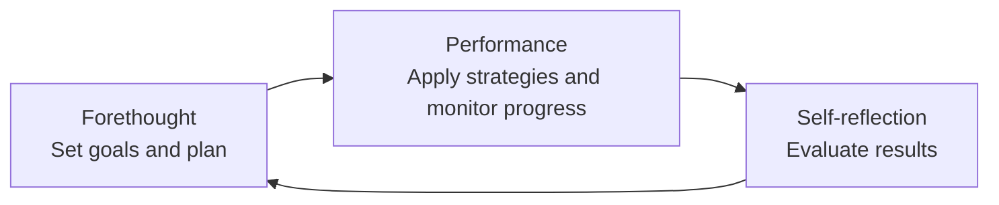
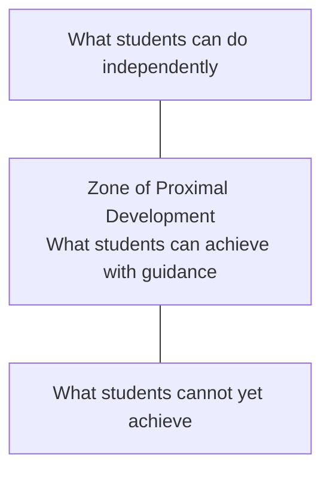

(c) 2026 Freek van den Berg. All rights reserved.

# LO1 Guiding Learning Processes

Guiding learning processes involves supporting students throughout their learning journey, encouraging independence, providing feedback, and selecting appropriate teaching methods. Two relevant frameworks are Self-Regulated Learning and the Zone of Proximal Development.

## Self-Regulated Learning – Zimmerman

The **Self-Regulated Learning (SRL) framework**, developed by educational psychologist **Barry Zimmerman**, explains how students take an active role in managing and improving their own learning. Self-regulated learning means that students do not simply follow instructions or depend entirely on their teacher. Instead, they learn to set their own goals, select appropriate learning strategies, monitor their progress, and evaluate the effectiveness of their approach.

An important characteristic of this framework is that learning is viewed as a **cyclical process**. Students use their experiences and reflections from previous learning activities to prepare for new ones. The framework consists of three interconnected phases:

1. **Forethought:** Before starting a learning activity, students analyse what they need to learn, establish learning goals, and plan how to achieve them.
2. **Performance:** While carrying out the learning activity, students apply their planned strategies, monitor their progress, and regulate their time, effort, and attention.
3. **Self-reflection:** After completing the activity, students evaluate their results and learning process, identify what worked well and what could be improved, and use these insights to guide their next learning activity.

The three phases are closely related. The forethought phase determines how students approach a learning task, the performance phase concerns how they execute and monitor their approach, and the self-reflection phase allows them to evaluate the outcome. The insights gained during reflection then influence the goals and strategies chosen for the next learning activity.

**The teacher's role** is to help students develop these self-regulation skills. This includes making learning objectives clear, providing appropriate learning strategies and resources, offering constructive feedback, and encouraging students to reflect on their progress. As students become more capable of regulating their own learning, the teacher can gradually reduce the amount of guidance and give them greater responsibility.

The ultimate aim of the SRL framework is to help students become **independent, motivated, and reflective learners** who can take responsibility for their own development, adapt their learning strategies when necessary, and continue learning throughout their professional lives.

**How I apply this framework:** My experience teaching Software Engineering, Functional Programming, and Systems Thinking at Fontys has shown me the importance of helping students structure their learning and monitor their own progress. When organising workshops and supervising internship students, I encourage learners to define objectives, divide complex tasks into manageable activities, evaluate their progress, and reflect on their results. I also apply this principle to my own professional development through academic research, professional activities, and online courses, including Udemy. I believe that students learn more effectively when they understand not only what they need to learn, but also how to manage and evaluate their own learning process.

## Zone of Proximal Development – Vygotsky

The **Zone of Proximal Development (ZPD)**, introduced by Lev Vygotsky, describes the difference between what a student can accomplish independently and what they can accomplish with guidance or support.

The framework distinguishes between:

- **Actual development level:** What students can do independently.
- **Zone of proximal development:** What students can achieve with appropriate guidance.
- **Potential development level:** What students may eventually accomplish independently after learning.

**Application in teaching:** I aim to provide sufficient support to help students overcome challenges without removing the responsibility for learning from them. Through explanations, examples, questions, and gradually reduced assistance (scaffolding), I help students develop confidence and independence.

**How I apply this framework:** My experience teaching and supervising students has taught me that learners have different levels of prior knowledge, confidence, and practical experience. I therefore try to identify what students can already accomplish independently and where additional guidance is needed. For example, when teaching programming, I can initially provide explanations, code examples, and structured exercises before gradually introducing more complex problems that students must solve independently. During internship supervision, I use questions, feedback, and targeted guidance to help students overcome difficulties rather than immediately providing solutions. My objective is to gradually reduce the amount of support as students develop the knowledge and confidence to work independently. I also consider it important to create a safe learning environment in which students can ask questions, experiment, and make mistakes without fear of judgement.
