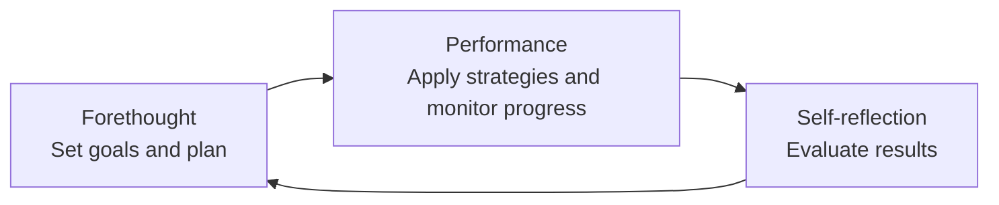
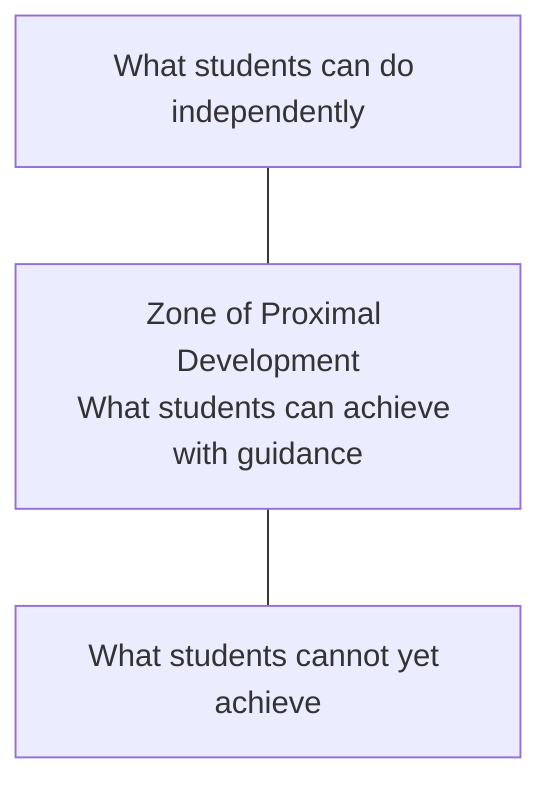

(c) 2026 Freek van den Berg. All rights reserved.

# LO1 Guiding Learning Processes

Guiding learning processes involves supporting students throughout their learning journey, encouraging independence, providing feedback, and selecting appropriate teaching methods. Two relevant frameworks are Self-Regulated Learning and the Zone of Proximal Development.

## Self-Regulated Learning – Zimmerman

The **Self-Regulated Learning (SRL) framework**, developed by educational psychologist **Barry Zimmerman**, explains how students take an active role in managing and improving their own learning. Self-regulated learning means that students do not simply follow instructions or depend entirely on their teacher. Instead, they learn to set their own goals, select appropriate learning strategies, monitor their progress, and evaluate the effectiveness of their approach.

An important characteristic of this framework is that learning is viewed as a **cyclical process**. Students use their experiences and reflections from previous learning activities to prepare for new ones. The framework consists of three interconnected phases:

1. **Forethought:** Before starting a learning activity, students analyse what they need to learn, establish learning goals, and plan how to achieve them.
2. **Performance:** While carrying out the learning activity, students apply their planned strategies, monitor their progress, and regulate their time, effort, and attention.
3. **Self-reflection:** After completing the activity, students evaluate their results and learning process, identify what worked well and what could be improved, and use these insights to guide their next learning activity.

The three phases are closely related. The forethought phase determines how students approach a learning task, the performance phase concerns how they execute and monitor their approach, and the self-reflection phase allows them to evaluate the outcome. The insights gained during reflection then influence the goals and strategies chosen for the next learning activity.

**The teacher's role** is to help students develop these self-regulation skills. This includes making learning objectives clear, providing appropriate learning strategies and resources, offering constructive feedback, and encouraging students to reflect on their progress. As students become more capable of regulating their own learning, the teacher can gradually reduce the amount of guidance and give them greater responsibility.

The ultimate aim of the SRL framework is to help students become **independent, motivated, and reflective learners** who can take responsibility for their own development, adapt their learning strategies when necessary, and continue learning throughout their professional lives.

**How I apply this framework:** My experience teaching Software Engineering, Functional Programming, and Systems Thinking at Fontys has shown me the importance of helping students structure their learning and monitor their own progress. When organising workshops and supervising internship students, I encourage learners to define objectives, divide complex tasks into manageable activities, evaluate their progress, and reflect on their results. I also apply this principle to my own professional development through academic research, professional activities, and online courses, including Udemy. I believe that students learn more effectively when they understand not only what they need to learn, but also how to manage and evaluate their own learning process.

## Zone of Proximal Development – Vygotsky

The **Zone of Proximal Development (ZPD)**, introduced by psychologist **Lev Vygotsky**, describes the difference between what a student can achieve independently and what they can achieve with appropriate guidance or support from a more knowledgeable person, such as a teacher or a more experienced peer.

The central idea of this framework is that students learn most effectively when they are challenged to perform tasks that are slightly beyond their current abilities but remain achievable with support. Tasks that are too easy provide limited opportunities for further development, whereas tasks that are too difficult may lead to frustration if students lack the necessary guidance. Effective teaching therefore involves identifying each student's current level of understanding and providing support that enables them to progress towards more advanced knowledge and skills.

The framework distinguishes between three developmental levels:

1. **Actual development level:** This represents what a student can already understand or accomplish independently, without assistance. It reflects the knowledge and skills the student has acquired through previous learning and experience.

2. **Zone of Proximal Development (ZPD):** This represents the range of tasks and concepts that a student cannot yet master independently but can successfully understand or complete with appropriate guidance. Such support may come from a teacher, another knowledgeable person, or a more experienced student. This is the area in which guided learning can promote further development.

3. **Potential development level:** This represents the level of competence a student can reach with guidance and support. Through learning and practice, skills that initially required assistance can gradually become skills that the student can perform independently. In this sense, the potential development level can become the student's actual development level over time.

### Scaffolding

An important teaching approach associated with the ZPD is **scaffolding**. Scaffolding refers to the temporary support provided to students while they are developing new knowledge or skills. The teacher adjusts the amount and type of support according to the student's needs and gradually reduces it as the student becomes more competent.

Examples of scaffolding include:

- **Explanations:** Introducing unfamiliar concepts and explaining the underlying principles.
- **Demonstrations:** Showing students how to approach a task before asking them to perform it independently.
- **Guiding questions:** Asking questions that encourage students to think critically and discover solutions themselves.
- **Worked examples:** Providing examples that demonstrate how to solve a problem step by step.
- **Structured exercises:** Breaking complex assignments into smaller, manageable activities.
- **Feedback:** Identifying misunderstandings and suggesting ways to improve.
- **Gradual reduction of support:** Allowing students to take increasing responsibility as their knowledge and confidence develop.

The objective is not to provide students with the answers, but to give them enough support to develop the ability to find answers themselves.

**How I apply this framework:** I apply the principles of the ZPD by considering students' existing knowledge, experience, and individual learning needs before introducing more challenging concepts. For example, when teaching programming, I would first establish whether students understand fundamental concepts such as variables, conditional statements, loops, and methods. I can then introduce more complex topics, such as object-oriented programming, by building on this existing knowledge.

Initially, I provide explanations, demonstrations, worked examples, and structured programming exercises. As students become more familiar with the concepts, I introduce increasingly complex problems and encourage them to develop their own solutions. Rather than immediately correcting every mistake or providing a complete solution, I use guiding questions and constructive feedback to help students identify and resolve problems independently.

My experience supervising internship students also relates to this approach. Students often encounter practical problems that they have not previously addressed. Instead of immediately providing solutions, I aim to understand their reasoning, ask questions, suggest relevant resources, and provide guidance where necessary. As their competence increases, I gradually reduce my involvement and encourage them to take greater responsibility for their work.

I also believe that creating a safe and supportive learning environment is essential when applying this framework. Students should feel comfortable asking questions, expressing uncertainty, experimenting, and making mistakes. Such an environment encourages students to take on challenges without being afraid of failure.

The ultimate objective of the ZPD is to help students move from **what they can achieve with assistance to what they can accomplish independently**. By providing appropriate guidance and gradually reducing support, I aim to develop students' knowledge, confidence, problem-solving abilities, and independence.
