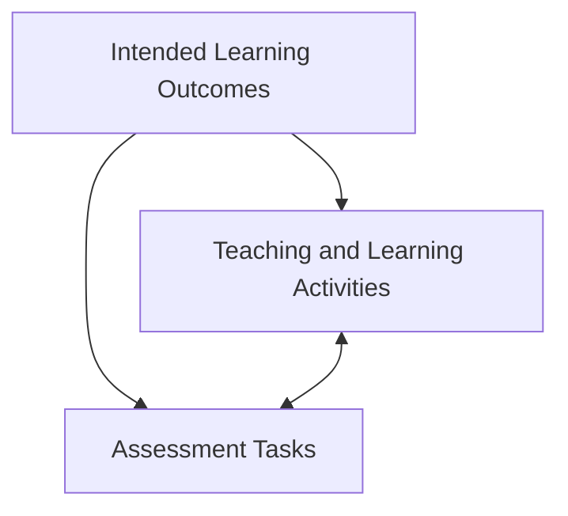
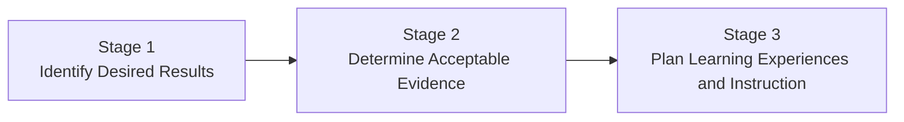

(c) 2026 Freek van den Berg. All rights reserved.

# LO2 Designing Education

Designing education involves developing coherent courses, defining learning objectives, selecting teaching activities, and creating appropriate assessment methods. Two relevant frameworks are Constructive Alignment and Backward Design.

## Constructive Alignment – John Biggs

**Constructive Alignment**, developed by educational researcher **John Biggs**, is an educational design framework that ensures consistency between intended learning outcomes, teaching and learning activities, and assessment tasks. The central principle is that all elements of a course should work together to support the learning process.

The term *constructive* refers to the idea that students actively construct their own understanding through learning activities and experiences. *Alignment* refers to the consistency between what students are expected to learn, the activities through which they develop their knowledge and skills, and the methods used to assess their achievement.

Constructive alignment encourages teachers to start by defining what students should learn and then design the teaching activities and assessments accordingly. The framework consists of three interconnected elements:

1. **Intended Learning Outcomes (ILOs):** These describe what students should know, understand, or be able to demonstrate at the end of a course or learning activity. Learning outcomes should be clearly formulated and describe observable or assessable achievements. For example, a learning outcome might state that students should be able to design, implement, test, and evaluate a software application. Bloom's taxonomy can help formulate learning outcomes at different cognitive levels, ranging from remembering and understanding to applying, analysing, evaluating, and creating.

2. **Teaching and Learning Activities (TLAs):** These are the activities through which students develop the knowledge and skills required to achieve the intended learning outcomes. Activities should actively engage students in the types of learning and thinking described by the outcomes. Examples include lectures, tutorials, discussions, programming exercises, practical assignments, workshops, group projects, and independent study. The selected activities should give students sufficient opportunities to practise and demonstrate the expected competencies.

3. **Assessment Tasks (ATs):** These are the methods used to determine whether students have achieved the intended learning outcomes. Assessment should measure the knowledge, skills, and competencies specified in the outcomes. Examples include written examinations, programming assignments, practical demonstrations, presentations, portfolios, and project evaluations. Assessment criteria should be transparent and clearly communicate what is expected of students.

#### The relationship between the three elements

The three elements must be aligned with one another:

- Learning outcomes define **what students should achieve**.
- Teaching and learning activities determine **how students develop the required knowledge and skills**.
- Assessment tasks establish **how achievement of the learning outcomes is evaluated**.

For example, if a learning outcome requires students to develop programming skills, teaching activities should include programming exercises and practical projects. Assessment should then involve implementing, testing, and evaluating software rather than relying exclusively on a theoretical examination.

A lack of alignment can create problems. For example, if students are expected to develop practical problem-solving skills but are assessed only through memorisation questions, the assessment does not adequately measure the intended learning outcomes. Similarly, if an assessment requires students to apply knowledge that they have not had the opportunity to practise, they may be unfairly disadvantaged.

#### Application in teaching

I use the principles of constructive alignment when considering how educational objectives, learning activities, and assessment methods should support one another. My teaching experience at Fontys University of Applied Sciences, particularly in Software Engineering and Functional Programming, has reinforced the importance of connecting theoretical knowledge with practical application.

For example, when designing a course on Software Engineering, I would first define the intended learning outcomes. These might include analysing software requirements, designing a software architecture, implementing a solution, and evaluating software quality. I would then select appropriate teaching and learning activities, such as lectures, programming exercises, workshops, and project-based assignments, to allow students to develop these competencies.

Finally, I would select assessment methods that correspond to the intended outcomes. Students could demonstrate their understanding through a combination of theoretical questions, practical programming assignments, and a software project. Clear assessment criteria would help students understand how their work is evaluated and what constitutes a successful result.

My experience as a Student Assessor at Radboud University has also strengthened my awareness of the importance of transparent assessment criteria and consistency between educational objectives and assessment methods. Students should understand not only what is expected of them but also how their achievements will be evaluated.

I consider constructive alignment particularly important because it helps ensure that education is purposeful, coherent, and fair. It encourages teachers to think carefully about the relationship between what they want students to learn, how students are supported in achieving those objectives, and how their progress is assessed.

Ultimately, constructive alignment helps create a learning environment in which **learning outcomes, teaching activities, and assessment reinforce one another**, giving students a clear understanding of what they are expected to achieve and providing meaningful opportunities to develop and demonstrate their competencies.

**How I apply this framework:** My teaching experience at Fontys, where I taught Software Engineering, Functional Programming, and Systems Thinking, has shown me the importance of connecting learning objectives, teaching activities, and assessment methods. When designing a course or individual learning activity, I first consider what students should know and be able to demonstrate by the end. I then select appropriate teaching methods, such as lectures, programming exercises, workshops, and practical assignments, to help them achieve these objectives. Finally, I ensure that assessment methods evaluate the intended knowledge and skills. My experience as a Student Assessor at Radboud University has also strengthened my awareness of the importance of transparent and appropriate assessment. I believe that students should understand what is expected of them and how their work will be evaluated.

## Backward Design – Wiggins and McTighe

**Backward Design**, developed by Grant Wiggins and Jay McTighe, is an approach to educational planning that starts with the desired learning outcomes rather than the teaching activities.

It consists of three stages:

1. **Identify desired results:** Define what students should know, understand, and be able to do.
2. **Determine acceptable evidence:** Decide how students will demonstrate that they have achieved the learning outcomes.
3. **Plan learning experiences and instruction:** Design the teaching activities and resources needed to achieve the outcomes.

**Application in teaching:** I find this framework useful because it encourages me to start with the intended educational goals and work backwards. It helps ensure that assessments measure relevant competencies and that teaching activities prepare students adequately.

**How I apply this framework:** I apply backward design by considering the desired competencies before deciding how to organise the educational activities. For example, when designing a course in Software Engineering, I would first identify the knowledge and practical skills students should acquire, such as analysing requirements, designing software architectures, implementing solutions, and evaluating software quality. I would then determine how students can demonstrate these competencies through assignments, projects, presentations, or examinations. Finally, I would organise lectures, tutorials, workshops, and practical exercises to prepare students for these assessments. My academic and research background, including two Master's degrees, a PhD, and three postdoctoral research appointments, has taught me the importance of clearly defining research questions, objectives, and expected outcomes before selecting appropriate methods. I apply the same principle to educational design: start with the intended destination and then determine the most
