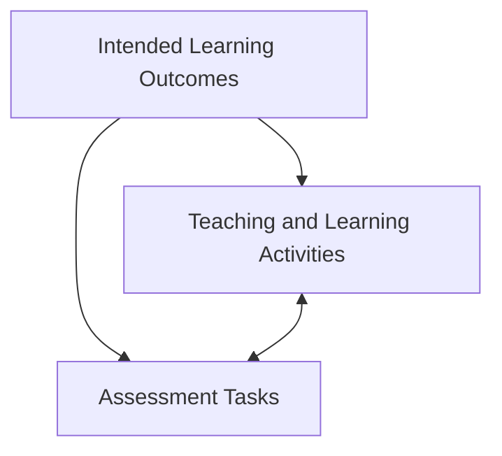
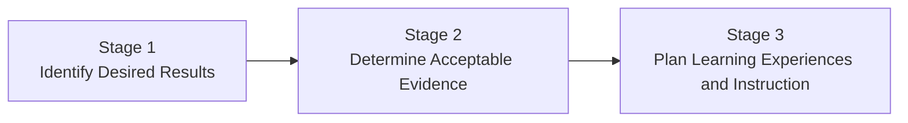

(c) 2026 Freek van den Berg. All rights reserved.

# LO2 Designing Education

Designing education involves **developing** well-structured, coherent, and **effective learning experiences** that align with intended learning outcomes, students' needs, and the **requirements of the curriculum**. It requires translating educational objectives into meaningful learning activities, selecting appropriate teaching methods, and designing assessments that allow students to demonstrate their knowledge and skills. As a teacher, I believe that effective education should combine **theoretical foundations** with **practical applications**, enabling students to understand not only how concepts work but also why they are relevant and how they can be applied to real-world problems.

When designing education, I aim to create an inclusive and engaging learning environment that encourages active participation, critical thinking, collaboration, and independent learning. I consider the diversity of students' backgrounds, prior knowledge, and learning styles when selecting educational approaches and materials. Furthermore, I believe that education should remain flexible and continuously improve through student feedback, assessment results, and reflection on teaching practices. By carefully aligning learning objectives, teaching activities, and assessment methods, I aim to design education that is meaningful, accessible, and prepares students for both professional practice and lifelong learning.

## Constructive Alignment – John Biggs

**Constructive Alignment** [[1]](#ref1)[[2]](#ref2)[[3]](#ref3)[[4]](#ref4), developed by educational researcher **John Biggs**, is an educational design framework that ensures consistency between intended learning outcomes, teaching and learning activities, and assessment tasks. The central principle is that all elements of a course should work together to support the learning process.

The term *constructive* refers to the idea that students actively construct their own understanding through learning activities and experiences. *Alignment* refers to the consistency between what students are expected to learn, the activities through which they develop their knowledge and skills, and the methods used to assess their achievement.

Constructive alignment encourages teachers to start by defining what students should learn and then design the teaching activities and assessments accordingly. The framework consists of three interconnected elements:

1. **Intended Learning Outcomes (ILOs):** These describe **what students should know**, understand, or be able to demonstrate at the end of a course or learning activity. Learning outcomes should be clearly formulated and describe observable or assessable achievements. For example, a learning outcome might state that students should be able to design, implement, test, and evaluate a software application. Bloom's taxonomy can help formulate learning outcomes at different cognitive levels, ranging from remembering and understanding to applying, analysing, evaluating, and creating.

2. **Teaching and Learning Activities (TLAs):** These are the **activities** through which **students develop the knowledge** and skills required to achieve the intended learning outcomes. Activities should actively engage students in the types of learning and thinking described by the outcomes. Examples include **lectures**, **tutorials**, **discussions**, programming **exercises**, practical **assignments**, **workshops**, group **projects**, and independent study. The selected activities should give students sufficient opportunities to practise and demonstrate the expected competencies.

3. **Assessment Tasks (ATs):** These are the methods used to determine whether students have achieved the intended learning outcomes. Assessment should **measure** the **knowledge**, **skills**, and **competencies** specified in the outcomes. Examples include written **examinations**, programming **assignments**, practical **demonstrations**, **presentations**, **portfolios**, and project **evaluations**. Assessment criteria should be transparent and clearly communicate what is expected of students.

#### The relationship between the three elements

The three elements must be aligned with one another:

- Learning outcomes define **what students should achieve**.
- Teaching and learning activities determine **how students develop the required knowledge and skills**.
- Assessment tasks establish **how achievement of the learning outcomes is evaluated**.

For example, if a learning outcome requires students to develop programming skills, teaching activities should include programming exercises and practical projects. Assessment should then involve implementing, testing, and evaluating software rather than relying exclusively on a theoretical examination.

A lack of alignment can create problems. For example, if students are expected to develop practical problem-solving skills but are assessed only through memorisation questions, the assessment does not adequately measure the intended learning outcomes. Similarly, if an assessment requires students to apply knowledge that they have not had the opportunity to practise, they may be unfairly disadvantaged.

#### Application in teaching

I use the principles of constructive alignment when considering how educational objectives, learning activities, and assessment methods should support one another. My teaching experience at Fontys University of Applied Sciences, particularly in Software Engineering and Functional Programming, has reinforced the importance of connecting theoretical knowledge with practical application.

For example, when designing a course on Software Engineering, I would first define the intended **learning outcomes**. These might include analysing software requirements, designing a software architecture, implementing a solution, and evaluating software quality. I would then select appropriate **teaching and learning activities**, such as lectures, programming exercises, workshops, and project-based assignments, to allow students to develop these competencies.
Finally, I would select **assessment methods** that correspond to the intended outcomes. Students could demonstrate their understanding through a combination of theoretical questions, practical programming assignments, and a software project. Clear assessment criteria would help students understand how their work is evaluated and what constitutes a successful result.

My experience as a Student Assessor at Radboud University has also strengthened my awareness of the importance of transparent assessment criteria and consistency between educational objectives and assessment methods. Students should understand not only what is expected of them but also how their achievements will be evaluated.

I consider constructive alignment particularly important because it helps ensure that education is purposeful, coherent, and fair. It encourages teachers to think carefully about the relationship between what they want students to learn, how students are supported in achieving those objectives, and how their progress is assessed.

Ultimately, constructive alignment helps create a learning environment in which **learning outcomes, teaching activities, and assessment reinforce one another**, giving students a clear understanding of what they are expected to achieve and providing meaningful opportunities to develop and demonstrate their competencies.

## Backward Design – Wiggins and McTighe

**Backward Design** [[5]](#ref5)[[6]](#ref6)[[7]](#ref7), developed by educational researchers **Grant Wiggins and Jay McTighe**, is an approach to educational planning that starts by identifying the desired learning outcomes and then works backwards to determine how students can achieve and demonstrate them.

Traditional course planning often begins by selecting topics, teaching materials, and classroom activities. Backward Design reverses this process. Instead of first deciding what the teacher will teach, the teacher begins by asking what students should know, understand, and be able to do by the end of a course or learning activity.

The central principle is that educational activities should be deliberately designed to support clearly defined learning objectives. Assessment methods should provide evidence that these objectives have been achieved, while teaching activities should prepare students to demonstrate the required knowledge and skills.

The framework consists of three interconnected stages:

#### 1. Identify Desired Results

The first stage involves defining the learning outcomes that students are expected to achieve. These outcomes describe the knowledge, understanding, skills, and competencies students should develop during a course or learning activity.

Teachers should consider:

- **Knowledge:** What information, concepts, theories, and principles should students know?
- **Understanding:** What should students understand beyond simply remembering information? For example, should they be able to explain relationships, interpret results, or recognise underlying principles?
- **Skills:** What should students be able to do? This might include solving problems, programming, analysing information, conducting experiments, or communicating results.
- **Transfer:** How should students apply their knowledge and skills in new situations or unfamiliar contexts?

Learning outcomes should be clearly formulated and sufficiently specific to guide the subsequent design of assessments and teaching activities. Bloom's taxonomy as explained below can help teachers define the expected level of cognitive development, ranging from remembering and understanding to applying, analysing, evaluating, and creating.

For example, in a Software Engineering course, desired learning outcomes might include:

- Explain fundamental software engineering principles.
- Analyse software requirements and identify relevant constraints.
- Design an appropriate software architecture.
- Implement a software solution using suitable programming techniques.
- Test and evaluate the quality of a software application.

Defining these outcomes first establishes a clear direction for the entire course.

The following table provides the processes of Bloom's taxonomy and provides an Java/OOP example for each of them.

| Level | Cognitive process | Main question | Example (Java / OOP) |
|---|---|---|---|
| **1. Remember** | Recall information | What do I know? | Identify and list the four fundamental principles of OOP: encapsulation, inheritance, polymorphism, and abstraction. |
| **2. Understand** | Explain concepts | What does it mean? | Explain the difference between inheritance and composition and describe when each approach is appropriate. |
| **3. Apply** | Use knowledge in practice | How can I use it? | Implement a Java application using classes, objects, interfaces, inheritance, and encapsulation. |
| **4. Analyse** | Examine relationships and structures | How does it work? | Analyse an existing software architecture, identify tightly coupled components, and explain their impact on maintainability and extensibility. |
| **5. Evaluate** | Assess and justify decisions | Is this the best solution? | Compare alternative software designs based on maintainability, scalability, performance, and code quality, and justify the preferred approach. |
| **6. Create** | Develop new ideas and solutions | What can I design or develop? | Independently design and implement a complete object-oriented application, selecting appropriate architectural patterns and justifying the design decisions. |

#### 2. Determine Acceptable Evidence

The second stage involves deciding how students will demonstrate that they have achieved the intended learning outcomes.

Teachers identify appropriate assessment methods and define the evidence that will demonstrate successful learning. The assessment should measure the competencies specified in the learning outcomes rather than simply test whether students can reproduce information.

Important considerations include:

- **Assessment methods:** Which methods are most appropriate for evaluating the intended knowledge and skills? Examples include written examinations, practical assignments, programming projects, presentations, portfolios, and demonstrations.
- **Assessment criteria:** What characteristics distinguish satisfactory from excellent performance? Criteria should be clearly defined and communicated to students.
- **Validity:** Does the assessment actually measure the knowledge, skills, or competencies it is intended to evaluate?
- **Reliability:** Would the assessment produce sufficiently consistent results under comparable conditions?
- **Transparency:** Do students understand what is expected of them and how their work will be evaluated?

For example, if students are expected to design and implement a software application, a theoretical examination alone would not provide sufficient evidence of their practical programming and design capabilities. A practical project, supported by documentation and a demonstration, would provide more appropriate evidence.

Assessment can also take place at different stages of the learning process:

- **Diagnostic assessment:** Establishes students' existing knowledge and identifies potential knowledge gaps before or at the beginning of instruction.
- **Formative assessment:** Monitors learning progress and provides feedback that students can use to improve.
- **Summative assessment:** Evaluates the extent to which students have achieved the intended learning outcomes at the end of a learning period.

Determining the assessment approach at this stage helps ensure that the learning outcomes can be meaningfully evaluated.

#### 3. Plan Learning Experiences and Instruction

The third stage involves designing the teaching activities, learning resources, and instructional approaches that will enable students to achieve the desired learning outcomes and prepare them for the assessments.

The teacher considers which learning experiences will provide students with the knowledge, practice, and guidance required to demonstrate the expected competencies.

Possible teaching and learning activities include:

- **Lectures:** Introduce theoretical concepts, principles, and foundational knowledge.
- **Tutorials:** Provide opportunities to discuss concepts, ask questions, and solve problems with guidance.
- **Practical exercises:** Allow students to apply theoretical knowledge and develop technical skills.
- **Workshops:** Encourage active participation, collaboration, experimentation, and practical problem-solving.
- **Project-based learning:** Enable students to integrate different competencies while working on realistic problems.
- **Independent study:** Encourage students to take responsibility for their learning and explore topics in greater depth.
- **Feedback and reflection:** Help students identify knowledge gaps, evaluate their progress, and improve their performance.

The selected activities should provide sufficient opportunities for students to practise the knowledge and skills required by the assessments. Teachers should also consider students' prior knowledge, learning needs, available resources, and the complexity of the subject.

For example, if students are expected to implement and test a software application, the course should include programming exercises, demonstrations, practical assignments, and opportunities to work with testing frameworks before the final project is assessed.

#### Relationship between the three stages

The three stages form a logical sequence:

1. **Identify desired results:** What should students know, understand, and be able to do?
2. **Determine acceptable evidence:** How will students demonstrate that they have achieved these results?
3. **Plan learning experiences and instruction:** Which activities and resources will prepare students to achieve the results and demonstrate their competencies?

The important characteristic of Backward Design is that teaching activities are selected only after the desired learning outcomes and assessment evidence have been established.

This approach helps prevent a common problem in educational design: organising a course around interesting topics or teaching activities without sufficiently considering whether they contribute to the intended learning outcomes.

#### Application in teaching

I find Backward Design useful because it encourages me to start with the intended educational goals and work backwards. It helps ensure that assessments measure relevant competencies and that teaching activities prepare students adequately.

My academic and research experience has taught me the importance of defining clear objectives before selecting methods to achieve them. The same principle applies to educational design: before deciding which topics to teach or which exercises to use, I consider what students should be able to demonstrate at the end of the learning process.

For example, when planning a Software Engineering course, I would first identify the desired competencies. Students might be expected to analyse requirements, design software architectures, implement solutions, and evaluate software quality.

Next, I would determine how these competencies could be assessed. Practical assignments, software projects, presentations, and examinations could provide evidence of students' theoretical understanding and practical abilities. I would also establish transparent assessment criteria so that students understand the expected standards.

Finally, I would design the learning activities to prepare students for these assessments. Lectures could introduce the theoretical foundations, tutorials could explore design principles, and programming exercises and workshops could provide opportunities to practise implementation and testing. A larger project could then allow students to integrate the knowledge and skills they have developed.

My teaching experience at Fontys University of Applied Sciences has reinforced the importance of combining theoretical explanations with practical exercises. I also consider my experience as a Student Assessor at Radboud University relevant, as it has strengthened my awareness of the importance of clear expectations and appropriate assessment.

I believe that Backward Design contributes to effective education because it encourages teachers to make deliberate decisions about the purpose of every learning activity. It also helps students understand the relationship between what they are expected to learn, the activities in which they participate, and the way their achievements are evaluated.

Ultimately, Backward Design helps create **purposeful, coherent, and goal-oriented education**, in which learning outcomes guide assessment and instructional decisions from the beginning.

**How I apply this framework:** I apply backward design by considering the desired competencies before deciding how to organise the educational activities. For example, when designing a course in Software Engineering, I would first identify the knowledge and practical skills students should acquire, such as analysing requirements, designing software architectures, implementing solutions, and evaluating software quality. I would then determine how students can demonstrate these competencies through assignments, projects, presentations, or examinations. Finally, I would organise lectures, tutorials, workshops, and practical exercises to prepare students for these assessments. My academic and research background, including two Master's degrees, a PhD, and three postdoctoral research appointments, has taught me the importance of clearly defining research questions, objectives, and expected outcomes before selecting appropriate methods. I apply the same principle to educational design: start with the intended destination and then determine the most

# References
-  [1] Biggs, John. "Enhancing teaching through constructive alignment." Higher education 32.3 (1996): 347-364.
-  [2] Biggs, John. "Constructive alignment." Retrieved April 6 (2001): 2015.
-  [3] Wang, Xiaoyan, et al. "An exploration of Biggs’ constructive alignment in course design and its impact on students’ learning approaches." Assessment & Evaluation in Higher Education 38.4 (2013): 477-491.
-  [4] Biggs, John, and Catherine Tang. "Constructive alignment: An outcomes-based approach to teaching anatomy." Teaching anatomy: A practical guide. Cham: Springer International Publishing, 2014. 31-38.
-  [5] McTighe, Jay, and Ronald S. Thomas. "Backward design for forward action." Educational leadership 60.5 (2003): 52-55.
-  [6] Wiggins, Grant, and Jay McTighe. "What is backward design." Understanding by design 1 (1998): 7-19.
-  [7] Wiggins, Grant P., Jay McTighe, and Jay McTighe. Understanding by design. Vol. 2. Alexandria, VA: Association for supervision and curriculum development, 2005.
