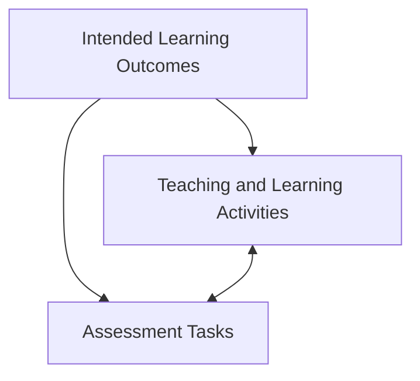
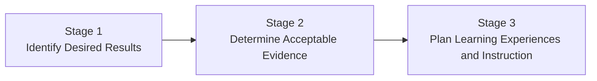

(c) 2026 Freek van den Berg. All rights reserved.

# LO2 Designing Education

Designing education involves developing coherent courses, defining learning objectives, selecting teaching activities, and creating appropriate assessment methods. Two relevant frameworks are Constructive Alignment and Backward Design.

## Constructive Alignment – John Biggs

**Constructive Alignment**, developed by John Biggs, is an educational design framework that ensures consistency between three fundamental elements:

1. **Intended Learning Outcomes:** What students should know or be able to do.
2. **Teaching and Learning Activities:** Activities that enable students to achieve the intended outcomes.
3. **Assessment Tasks:** Methods used to evaluate whether students have achieved the outcomes.

**Application in teaching:** I use constructive alignment to ensure that learning activities and assessments directly support the intended learning outcomes. For example, if students must develop programming skills, the course should include practical programming assignments rather than relying exclusively on theoretical examinations.

**How I apply this framework:** My teaching experience at Fontys, where I taught Software Engineering, Functional Programming, and Systems Thinking, has shown me the importance of connecting learning objectives, teaching activities, and assessment methods. When designing a course or individual learning activity, I first consider what students should know and be able to demonstrate by the end. I then select appropriate teaching methods, such as lectures, programming exercises, workshops, and practical assignments, to help them achieve these objectives. Finally, I ensure that assessment methods evaluate the intended knowledge and skills. My experience as a Student Assessor at Radboud University has also strengthened my awareness of the importance of transparent and appropriate assessment. I believe that students should understand what is expected of them and how their work will be evaluated.

## Backward Design – Wiggins and McTighe

**Backward Design**, developed by Grant Wiggins and Jay McTighe, is an approach to educational planning that starts with the desired learning outcomes rather than the teaching activities.

It consists of three stages:

1. **Identify desired results:** Define what students should know, understand, and be able to do.
2. **Determine acceptable evidence:** Decide how students will demonstrate that they have achieved the learning outcomes.
3. **Plan learning experiences and instruction:** Design the teaching activities and resources needed to achieve the outcomes.

**Application in teaching:** I find this framework useful because it encourages me to start with the intended educational goals and work backwards. It helps ensure that assessments measure relevant competencies and that teaching activities prepare students adequately.

**How I apply this framework:** I apply backward design by considering the desired competencies before deciding how to organise the educational activities. For example, when designing a course in Software Engineering, I would first identify the knowledge and practical skills students should acquire, such as analysing requirements, designing software architectures, implementing solutions, and evaluating software quality. I would then determine how students can demonstrate these competencies through assignments, projects, presentations, or examinations. Finally, I would organise lectures, tutorials, workshops, and practical exercises to prepare students for these assessments. My academic and research background, including two Master's degrees, a PhD, and three postdoctoral research appointments, has taught me the importance of clearly defining research questions, objectives, and expected outcomes before selecting appropriate methods. I apply the same principle to educational design: start with the intended destination and then determine the most
