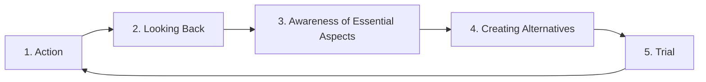
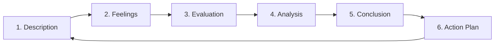

(c) 2026 Freek van den Berg. All rights reserved.

# LO3 Professional Development as a Teacher

Professional development involves reflecting on teaching practices, identifying areas for improvement, using feedback, and continuously developing professional competencies. Two relevant frameworks are the ALACT Model and Gibbs' Reflective Cycle.

## ALACT Model – Fred Korthagen

The **ALACT model** [[1]](#ref1), developed by educational researcher **Fred Korthagen**, is a framework for structured reflection and professional development. It helps teachers analyse their professional experiences, understand the factors that influence their actions, and identify ways to improve their teaching practice.

The model is based on the idea that professional development does not happen simply through gaining experience. Experience becomes valuable for development when professionals actively reflect on what happened, examine their decisions, consider alternative approaches, and apply what they have learned in new situations.

The name ALACT is derived from the first letters of its five phases:

1. **Action:** Carry out a professional activity.
2. **Looking back:** Reflect on the experience and what happened.
3. **Awareness of essential aspects:** Identify important factors, underlying assumptions, and possible causes.
4. **Creating alternative methods of action:** Consider different approaches and possible improvements.
5. **Trial:** Apply an alternative approach in practice and evaluate its effectiveness.

The five phases form a continuous cycle. The outcome of one reflection process becomes the starting point for the next, allowing teachers to continuously evaluate and improve their professional practice.

#### 1. Action

The first phase involves carrying out a professional activity or performing a task in a real educational situation. This could involve teaching a lecture, organising a workshop, supervising a student, assessing an assignment, or facilitating a group discussion.

At this stage, the teacher focuses on performing the activity and responding to the circumstances that arise. Although the activity may have been carefully planned, unexpected situations can occur. Students may have different levels of prior knowledge, misunderstand an explanation, ask unexpected questions, or experience difficulties with an assignment.

These situations provide opportunities for later reflection.

For example, when teaching a programming class, I might introduce a new programming concept, demonstrate its application, and ask students to complete a practical exercise. During the activity, I observe how students respond, which questions they ask, and where they encounter difficulties.

#### 2. Looking Back

The second phase involves looking back at the experience and reconstructing what happened. The objective is to examine the activity objectively and identify relevant observations.

Teachers can consider questions such as:

- What happened during the teaching activity?
- What was I trying to achieve?
- How did students respond?
- Which parts of the activity went well?
- Where did students encounter difficulties?
- Did I achieve the intended learning objectives?
- How did I respond to unexpected situations?

It is important to distinguish between observations and interpretations. For example, observing that several students did not complete an exercise is different from concluding that they lacked motivation. The latter is an interpretation that requires further investigation.

Feedback from students and colleagues can provide additional perspectives and help identify aspects that may not have been apparent during the activity.

For example, after a programming workshop, I might observe that students understood the theoretical explanation but struggled to apply the concept independently. This observation provides a starting point for further analysis.

#### 3. Awareness of Essential Aspects

The third phase involves analysing the experience in greater depth to identify the important factors that influenced the outcome. Rather than simply describing what happened, the teacher examines why it happened and considers the relationship between their own actions, students' responses, and the learning environment.

Questions to consider include:

- Why did students respond in this particular way?
- Were the learning objectives sufficiently clear?
- Was the difficulty level appropriate for the students' prior knowledge?
- Were the teaching methods suitable for the subject and learning objectives?
- Did I provide sufficient explanations, examples, and guidance?
- Were there assumptions in my approach that should be reconsidered?
- How might my own behaviour or expectations have influenced the situation?

This phase requires critical self-reflection. Teachers should be willing to question their own decisions and recognise that difficulties do not necessarily originate from students. The structure of an assignment, the explanation of a concept, the choice of teaching method, or the amount of guidance provided may also contribute to the situation.

For example, if students struggle with a programming exercise, the problem may not be a lack of ability or motivation. The exercise might require knowledge that has not yet been sufficiently explained or practised. Alternatively, the assignment might contain several unfamiliar concepts at once, making it unnecessarily difficult.

Recognising these underlying factors helps teachers understand what needs to change.

#### 4. Creating Alternative Methods of Action

In the fourth phase, teachers use the insights gained during the analysis to consider alternative approaches. The objective is to identify practical improvements that could lead to better learning experiences or outcomes.

Possible questions include:

- What could I have done differently?
- Which alternative teaching methods could I use?
- Could I explain the concept using another example?
- Would additional exercises or demonstrations help?
- Should I divide a complex assignment into smaller steps?
- Could I provide more opportunities for discussion or collaboration?
- How could I adapt my approach to accommodate different levels of prior knowledge?

At this stage, it is useful to consider several alternatives rather than immediately selecting the first possible solution. Teachers can also consult educational literature, colleagues, or student feedback to explore different approaches.

For example, if students struggle to apply a programming concept, possible improvements might include introducing a simpler worked example, providing a step-by-step exercise, organising a short interactive demonstration, or allowing students to discuss solutions in small groups.

The alternatives should be realistic and appropriate for the learning objectives, students' needs, and available resources.

#### 5. Trial

The fifth phase involves putting the selected alternative into practice. The teacher applies the proposed improvement in a subsequent teaching activity and evaluates whether it produces better results.

Questions to consider include:

- Did the alternative approach improve students' understanding?
- Were students able to complete the exercise more independently?
- Did participation and engagement improve?
- Were the intended learning outcomes achieved?
- What additional improvements might still be necessary?

The trial does not necessarily have to produce the desired result immediately. If the alternative approach is unsuccessful, this also provides valuable information for further reflection.

For example, I might introduce additional worked examples and divide a complex programming assignment into smaller exercises. During the next workshop, I would observe whether students are better able to apply the concepts independently. I could also collect feedback and review the results of the exercises to determine whether the changes were effective.

The results of the trial then become the starting point for another cycle of reflection and improvement.

### Application in teaching

I consider the ALACT model particularly useful because teaching involves continuous interaction with students, changing circumstances, and different learning needs. Even carefully prepared educational activities do not always produce the expected results. Reflection provides an opportunity to understand these situations and improve future teaching activities.

I can apply the model to my teaching experience at Fontys University of Applied Sciences, where I taught Software Engineering, Functional Programming, and Systems Thinking. For example, after delivering a lecture or organising a workshop, I can evaluate whether students understood the material, whether the exercises supported the intended learning outcomes, and which aspects of the activity could be improved.

My experience as a Student Assistant and Student Assessor at Radboud University, as well as my experience supervising internship students, also provides opportunities for reflection. When guiding or assessing students, I can consider whether my explanations were sufficiently clear, whether my feedback was constructive, and whether I provided the appropriate balance between guidance and independence.

I also consider feedback from students and colleagues an important part of professional development. Different perspectives can reveal aspects of my teaching that I might otherwise overlook. Rather than treating feedback as criticism, I view it as an opportunity to understand how my teaching is experienced by others and identify possible improvements.

An important aspect of my teaching philosophy is that **teachers should also be willing to make mistakes, acknowledge them, and learn from them**. A teacher is not expected to know everything or to have an immediate answer to every question. Recognising uncertainty, correcting misunderstandings, and adapting one's approach are important elements of professional development.

This attitude also contributes to a safe learning environment. When teachers demonstrate that mistakes are part of the learning process, students are more likely to feel comfortable asking questions, experimenting, and acknowledging their own difficulties.

Ultimately, the ALACT model reinforces my belief that professional development is a continuous process. By systematically reflecting on experiences, examining underlying factors, considering alternatives, and testing improvements, I aim to become a more effective, reflective, and adaptable teacher.

**How I apply this framework:** I can apply the ALACT model to my teaching experience at Fontys University of Applied Sciences, where I taught Software Engineering, Functional Programming, and Systems Thinking. For example, after a lecture or workshop, I reflect on whether students understood the material, whether the activities supported the intended learning outcomes, and which aspects could be improved. I use observations, student questions, assessment results, and feedback to identify areas for development. I then consider alternative explanations, teaching methods, or exercises and try them in subsequent sessions. My experience as a Student Assistant and Student Assessor at Radboud University, as well as supervising internship students, also provides opportunities to reflect on how I guide, assess, and support students. By repeating this process, I aim to continuously improve my teaching practice.

## Gibbs' Reflective Cycle – Graham Gibbs

**Gibbs' Reflective Cycle**, developed by educational researcher **Graham Gibbs**, is a structured framework for reflecting on experiences, analysing professional practice, and identifying opportunities for improvement. It is particularly useful in education because teaching involves continuous interaction with students, colleagues, learning materials, and different educational situations.

The framework encourages teachers to look beyond simply describing what happened. It provides a systematic way to examine their experiences, consider their thoughts and feelings, evaluate the effectiveness of their actions, understand the reasons behind particular outcomes, and identify concrete improvements for future situations.

Gibbs' model consists of six interconnected stages:

1. **Description:** What happened?
2. **Feelings:** What were my thoughts and feelings?
3. **Evaluation:** What went well and what did not?
4. **Analysis:** Why did things happen as they did?
5. **Conclusion:** What could I have done differently?
6. **Action Plan:** What will I do next time?

The six stages form a cycle because the action plan developed at the end can be applied to a future situation, which then provides new experiences for reflection.

#### 1. Description

The first stage involves describing the experience or situation that will be reflected upon. The objective is to establish a clear and factual understanding of what happened, without immediately judging whether the experience was successful or unsuccessful.

In an educational context, the experience might involve delivering a lecture, organising a workshop, assessing student assignments, supervising an internship student, or handling a challenging classroom situation.

Questions to consider include:

- What happened?
- When and where did the situation occur?
- Who was involved?
- What was the objective of the activity?
- What actions did I take?
- How did students respond?
- What was the eventual outcome?

For example, after delivering a programming workshop, I might describe the topics covered, the exercises students completed, the questions they asked, and the difficulties they encountered. I would also record whether the planned activities were completed within the available time.

The purpose of this stage is to establish the context for the subsequent reflection.

#### 2. Feelings

The second stage focuses on the thoughts, emotions, and expectations experienced during the situation and afterwards. Understanding these feelings can help teachers recognise how their own attitudes, assumptions, and reactions influence their professional behaviour.

Questions to consider include:

- What was I thinking before the activity?
- How did I feel during the teaching activity?
- Did I feel confident, uncertain, frustrated, or satisfied?
- How did I respond emotionally to unexpected situations?
- How might students have felt?
- How do I feel about the experience now?
- Have my feelings changed after reflecting on what happened?

For example, I might initially feel confident when introducing a programming concept but become uncertain when several students struggle to understand the explanation. I might also feel frustrated if an exercise takes considerably longer than expected.

Recognising these feelings does not mean that they should determine the evaluation of the situation. Instead, acknowledging them helps teachers understand their reactions and consider whether these influenced their decisions.

This stage also encourages empathy by considering the possible experiences and emotions of students. Students may feel uncertain or reluctant to ask questions, particularly when they are struggling with unfamiliar material.

#### 3. Evaluation

The third stage involves evaluating the experience by identifying what went well and what did not. The objective is to consider both positive and negative aspects of the situation.

Questions to consider include:

- Which aspects of the activity were successful?
- Did students achieve the intended learning objectives?
- Were the explanations and learning materials effective?
- Did students participate actively?
- Which aspects were less successful?
- Were there unexpected difficulties?
- What feedback did students or colleagues provide?

For example, during a programming workshop, students might have actively participated in discussions and successfully completed the initial exercises. However, some students might have struggled with the more complex assignments, suggesting that additional explanations or intermediate exercises would have been helpful.

It is important to consider both successes and difficulties. Successful elements should be recognised and retained, while less successful elements provide opportunities for improvement.

Feedback from students, colleagues, assessment results, and personal observations can provide valuable evidence for this evaluation.

#### 4. Analysis

The fourth stage involves examining the experience in greater depth to understand why particular events occurred and what factors influenced the outcome.

Whereas the evaluation stage identifies what went well and what did not, the analysis stage investigates the underlying reasons.

Questions to consider include:

- Why did certain aspects of the activity work well?
- Why did students experience difficulties?
- Were the learning objectives sufficiently clear?
- Was the complexity of the material appropriate?
- Did students have the necessary prior knowledge?
- Were the selected teaching methods suitable?
- Did I provide sufficient guidance and feedback?
- Could the learning environment or organisation have influenced the outcome?
- Are there educational theories or frameworks that help explain the situation?

For example, if students struggled with a programming exercise, several factors might explain the difficulties. The exercise may have introduced too many unfamiliar concepts simultaneously, students may not have had sufficient opportunities to practise the underlying principles, or the instructions may not have been sufficiently clear.

Educational frameworks can help interpret these situations. For example, Vygotsky's Zone of Proximal Development can help explain why students may struggle when a task is beyond their current abilities without appropriate guidance. Similarly, Self-Regulated Learning can help identify whether students need additional support with planning, monitoring, or evaluating their learning.

This stage is particularly important because it encourages teachers to look beyond the immediate symptoms of a problem and investigate its underlying causes.

#### 5. Conclusion

The fifth stage involves drawing conclusions from the previous stages and identifying what could have been done differently. The objective is to translate the analysis into lessons that can be applied in future teaching situations.

Questions to consider include:

- What have I learned from this experience?
- What did I do well?
- What could I have done differently?
- Which alternative teaching approaches might have been more effective?
- What should I retain in future activities?
- What knowledge or skills do I need to develop further?

For example, I might conclude that the programming workshop was effective in introducing the theoretical concepts, but that students needed more structured opportunities to practise before attempting the final assignment.

I might also recognise that I could have identified students' difficulties earlier by asking more questions, checking their understanding, or providing formative assessment during the workshop.

The conclusion should be based on the observations and analysis rather than assumptions. It should identify specific lessons that can guide future improvements.

#### 6. Action Plan

The final stage involves developing a concrete plan for improving future practice. The objective is to translate the insights gained during reflection into practical actions.

Questions to consider include:

- What will I do differently next time?
- Which teaching methods or resources should I change?
- Do I need to develop additional knowledge or skills?
- How will I recognise whether the improvement has been successful?
- What feedback or evidence will I collect?
- When will I evaluate the results?

For example, based on the previous programming workshop, I might decide to:

- Introduce an additional worked example before the practical exercise.
- Divide complex assignments into smaller, progressive tasks.
- Include short questions to check students' understanding.
- Provide additional opportunities for independent practice.
- Collect student feedback at the end of the session.
- Review the results before delivering the next workshop.

The action plan should be specific and realistic. It should also include a way to evaluate whether the proposed changes have improved the learning experience.

The next time I deliver a similar workshop, I can examine whether the changes have produced better results. This new experience then becomes the starting point for another reflection cycle.

#### Application in teaching

I consider Gibbs' Reflective Cycle useful for analysing individual teaching experiences in a structured and systematic way. Whereas the ALACT model provides a framework for professional reflection and experimentation, Gibbs' model explicitly encourages me to consider the emotional aspects of an experience and examine both positive and negative outcomes before developing an action plan.

I can apply this framework to my teaching experience at Fontys University of Applied Sciences, where I taught Software Engineering, Functional Programming, and Systems Thinking. For example, after delivering a lecture or organising a workshop, I can use the six stages to examine whether the learning objectives were achieved, how students responded, which teaching methods were effective, and what could be improved.

My experience as a Student Assistant and Student Assessor at Radboud University also provides opportunities for reflection. When assessing student work, I can consider whether my feedback was clear, constructive, and actionable. When supporting students, I can reflect on whether I provided an appropriate balance between guidance and independence.

Similarly, when supervising internship students, I can evaluate how effectively I supported their progress, whether I encouraged independent problem-solving, and whether my guidance was appropriate to their individual needs.

I also consider feedback from students and colleagues an important source of information. However, reflection should not be limited to external feedback. It is equally important to examine my own assumptions, decisions, expectations, and reactions. Sometimes, an activity that initially appears unsuccessful can reveal valuable insights about the learning process and my own teaching approach.

An important principle in my teaching philosophy is that **teachers should also be willing to acknowledge uncertainty, make mistakes, and learn from them**. I do not consider teaching a process in which the teacher always has the correct answer or the perfect approach. Instead, I see it as a continuous process of learning and development. The willingness to recognise mistakes and use them constructively is an important part of becoming a more effective educator.

#### Conclusion

Gibbs' Reflective Cycle provides a practical framework for turning teaching experiences into opportunities for professional development. By describing experiences, recognising feelings, evaluating outcomes, analysing underlying factors, drawing conclusions, and developing action plans, teachers can systematically improve their educational practice.

I believe that effective teaching requires continuous reflection and a willingness to adapt. Every lecture, workshop, assessment, and student interaction provides an opportunity to learn something new. By applying Gibbs' Reflective Cycle, I aim to become a more reflective, responsive, and effective teacher who continuously improves the learning experiences and development opportunities provided to students.

**How I apply this framework:** I use Gibbs' Reflective Cycle to examine specific teaching situations in greater detail. For example, when a programming exercise proves difficult for students, I first describe the situation and consider how students responded. I then reflect on my own feelings and expectations, evaluate what worked well and what did not, and analyse possible causes. These might include the complexity of the exercise, students' prior knowledge, the clarity of my explanation, or the amount of guidance provided. Based on this analysis, I identify what I could have done differently and formulate an action plan, such as introducing additional examples, dividing the exercise into smaller steps, or providing more opportunities for practice. I can then apply these changes in a subsequent session and evaluate their effectiveness.

Both frameworks support my belief that professional development is a continuous process. Teaching is not simply about transferring knowledge; it also requires teachers to remain open to feedback, question their own assumptions, and learn from experience. I aim to create a learning environment in which students feel safe to make mistakes and learn from them, while demonstrating the same willingness to reflect and improve in my own teaching practice.

# References
 Korthagen, Fred. "Inconvenient truths about teacher learning: Towards professional development 3.0." Teachers and teaching 23.4 (2017): 387-405.

