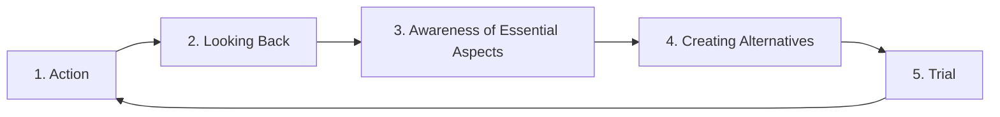
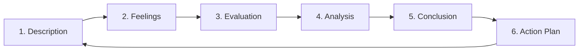

(c) 2026 Freek van den Berg. All rights reserved.

# LO3 Professional Development as a Teacher

Professional development involves reflecting on teaching practices, identifying areas for improvement, using feedback, and continuously developing professional competencies. Two relevant frameworks are the ALACT Model and Gibbs' Reflective Cycle.

## ALACT Model – Fred Korthagen

The **ALACT model**, developed by Fred Korthagen, provides a structured approach to professional reflection. It consists of five phases:

1. **Action:** Perform a teaching activity.
2. **Looking back:** Reflect on what happened.
3. **Awareness:** Identify important aspects and underlying factors.
4. **Creating alternatives:** Consider alternative approaches and improvements.
5. **Trial:** Apply an alternative approach and evaluate its effectiveness.

**Application in teaching:** I use reflection to evaluate my teaching activities, identify challenges, and improve my educational approach. Feedback from students and colleagues is an important input. I also believe that teachers should be willing to acknowledge their mistakes and learn from them.

**How I apply this framework:** I can apply the ALACT model to my teaching experience at Fontys University of Applied Sciences, where I taught Software Engineering, Functional Programming, and Systems Thinking. For example, after a lecture or workshop, I reflect on whether students understood the material, whether the activities supported the intended learning outcomes, and which aspects could be improved. I use observations, student questions, assessment results, and feedback to identify areas for development. I then consider alternative explanations, teaching methods, or exercises and try them in subsequent sessions. My experience as a Student Assistant and Student Assessor at Radboud University, as well as supervising internship students, also provides opportunities to reflect on how I guide, assess, and support students. By repeating this process, I aim to continuously improve my teaching practice.

## Gibbs' Reflective Cycle – Graham Gibbs

**Gibbs' Reflective Cycle**, developed by Graham Gibbs, provides a systematic approach to analysing experiences and identifying opportunities for improvement.

It consists of six stages:

1. **Description:** What happened?
2. **Feelings:** What were my thoughts and feelings?
3. **Evaluation:** What went well and what did not?
4. **Analysis:** Why did things happen as they did?
5. **Conclusion:** What could I have done differently?
6. **Action Plan:** What will I do next time?

**Application in teaching:** I consider this framework useful for reflecting on individual teaching experiences, such as lectures, workshops, assessments, and student supervision. It helps transform experiences and feedback into concrete improvements.

**How I apply this framework:** I use Gibbs' Reflective Cycle to examine specific teaching situations in greater detail. For example, when a programming exercise proves difficult for students, I first describe the situation and consider how students responded. I then reflect on my own feelings and expectations, evaluate what worked well and what did not, and analyse possible causes. These might include the complexity of the exercise, students' prior knowledge, the clarity of my explanation, or the amount of guidance provided. Based on this analysis, I identify what I could have done differently and formulate an action plan, such as introducing additional examples, dividing the exercise into smaller steps, or providing more opportunities for practice. I can then apply these changes in a subsequent session and evaluate their effectiveness.

Both frameworks support my belief that professional development is a continuous process. Teaching is not simply about transferring knowledge; it also requires teachers to remain open to feedback, question their own assumptions, and learn from experience. I aim to create a learning environment in which students feel safe to make mistakes and learn from them, while demonstrating the same willingness to reflect and improve in my own teaching practice.
