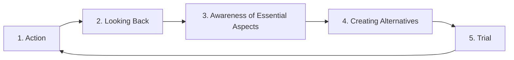
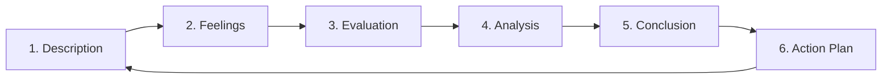

# LO3 Professional Development as a Teacher

Professional development involves reflecting on teaching practices, identifying areas for improvement, using feedback, and continuously developing professional competencies. Two relevant frameworks are the ALACT Model and Gibbs' Reflective Cycle.

## ALACT Model – Fred Korthagen

The **ALACT model**, developed by Fred Korthagen, provides a structured approach to professional reflection. It consists of five phases:

1. **Action:** Perform a teaching activity.
2. **Looking back:** Reflect on what happened.
3. **Awareness:** Identify important aspects and underlying factors.
4. **Creating alternatives:** Consider alternative approaches and improvements.
5. **Trial:** Apply an alternative approach and evaluate its effectiveness.

**Application in teaching:** I use reflection to evaluate my teaching activities, identify challenges, and improve my educational approach. Feedback from students and colleagues is an important input. I also believe that teachers should be willing to acknowledge their mistakes and learn from them.

## Gibbs' Reflective Cycle – Graham Gibbs

**Gibbs' Reflective Cycle**, developed by Graham Gibbs, provides a systematic approach to analysing experiences and identifying opportunities for improvement.

It consists of six stages:

1. **Description:** What happened?
2. **Feelings:** What were my thoughts and feelings?
3. **Evaluation:** What went well and what did not?
4. **Analysis:** Why did things happen as they did?
5. **Conclusion:** What could I have done differently?
6. **Action Plan:** What will I do next time?

**Application in teaching:** I consider this framework useful for reflecting on individual teaching experiences, such as lectures, workshops, assessments, and student supervision. It helps transform experiences and feedback into concrete improvements.
