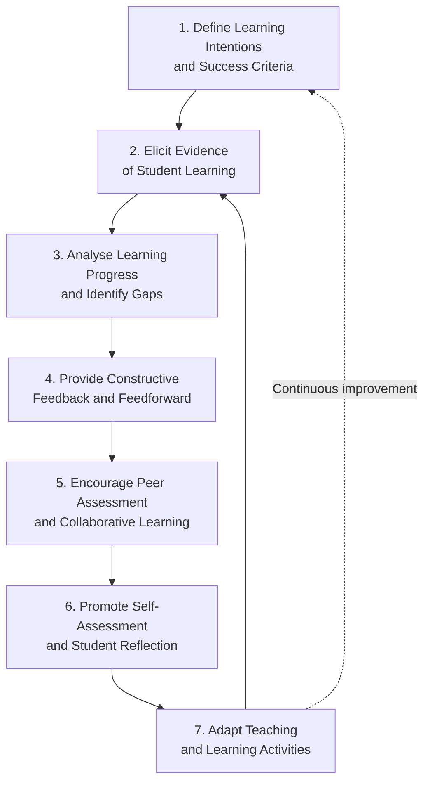

(c) 2026 Freek van den Berg. All rights reserved.

# LO4 Examining and Assessing
Examining and Assessing focuses on designing, applying, and evaluating assessment methods to determine whether students have achieved the intended learning outcomes. It involves understanding the differences between diagnostic, formative, and summative assessment, and ensuring that examinations are valid, reliable, transparent, and fair. Teachers should select appropriate assessment methods that align with learning objectives and allow students to demonstrate their knowledge, skills, and competencies.

An important aspect of this learning outcome is using assessment as a tool to support and improve learning rather than merely measuring performance. Through formative assessment, teachers identify knowledge gaps, monitor student progress, and adapt their teaching strategies. Constructive feedback and feedforward help students understand their strengths, recognise areas for improvement, and take responsibility for their development. The frameworks of Assessment for Learning (Black and Wiliam) and the Feedback Model (Hattie and Timperley) provide valuable foundations for putting these principles into practice.

## Assessment for Learning – Black and Wiliam

**Assessment for Learning (AfL)** is an educational approach developed through the influential research of Paul Black and Dylan Wiliam. It focuses on using assessment not merely to measure what students have learned, but also to actively improve their learning while it is taking place.

The central idea is that assessment should be an ongoing part of the teaching and learning process. Rather than waiting until the end of a course to discover whether students have understood the material, teachers continuously gather information about students' knowledge, skills, understanding and difficulties. They use this information to adapt their teaching, provide feedback and help students identify areas for improvement.

### 1. The Main Principles of Assessment for Learning

Black and Wiliam's approach emphasises that assessment becomes effective when the information gathered is used to make better educational decisions.

There are five key strategies associated with their framework:

#### 1.1 Clarifying and Sharing Learning Intentions and Success Criteria

Students need to understand **what they are expected to learn and how their work will be evaluated**. Teachers should communicate learning objectives clearly and explain what successful performance looks like.

For example, in a programming course, an objective might be that students can implement a Java application using object-oriented principles. The teacher should explain the assessment criteria, such as correct functionality, appropriate use of classes and interfaces, code quality, and maintainability.

This helps students understand the expectations before starting an assignment and allows them to monitor their own progress.

#### 1.2 Eliciting Evidence of Student Learning

Teachers need to continuously gather information to understand what students know, what they have understood and where they experience difficulties. This can be achieved through classroom discussions, questions, quizzes, practical exercises, assignments and observations.

For example, after explaining Java inheritance, a teacher could ask students to implement a small class hierarchy. By examining their solutions and asking questions about their design choices, the teacher can identify whether students understand inheritance or are simply reproducing examples.

The important aspect is that assessment activities should reveal students' actual understanding, not merely whether they can reproduce information.

#### 1.3 Providing Feedback That Moves Learners Forward

Feedback should help students understand what they have done well, what needs improvement and how they can improve. Effective feedback is specific, constructive and actionable rather than simply providing a grade or indicating whether an answer is correct or incorrect.

For example, instead of telling a student that their Java implementation is incorrect, the teacher could explain that the implementation works but violates the Single Responsibility Principle. The teacher could then suggest separating the responsibilities into different classes.

Feedback should encourage improvement and help students become more independent learners.

#### 1.4 Activating Students as Learning Resources for One Another

Students can support each other's learning by sharing knowledge, discussing solutions and providing constructive feedback. Peer learning encourages collaboration and exposes students to different approaches to solving problems.

For example, students could review each other's programming assignments, discuss alternative implementations and identify potential improvements. By explaining their reasoning to classmates, students also strengthen their own understanding.

The teacher facilitates this process by establishing clear expectations for constructive and respectful peer feedback.

#### 1.5 Activating Students as Owners of Their Own Learning

Students should gradually develop the ability to evaluate their own progress, recognise knowledge gaps and take responsibility for improving their performance. This involves self-assessment, reflection, goal setting and monitoring individual learning progress.

For example, after completing a programming assignment, students could reflect on which concepts they understood well, where they encountered difficulties and what they would approach differently next time.

This encourages self-regulated learning and helps students become independent, reflective learners.

### 2. The Three Fundamental Questions

The five strategies can be organised around three fundamental questions:

| Question | Purpose |
|---|---|
| Where is the student going? | Establish learning objectives and success criteria. |
| Where is the student right now? | Identify current knowledge, understanding and difficulties. |
| How can the student get there? | Provide feedback, guidance and opportunities for improvement. |

These questions connect the activities of teachers, students and peers. Assessment therefore becomes a continuous process involving everyone in the learning environment.

#### Assessment for Learning Cycle

The following diagram illustrates how the five strategies can be applied within a continuous teaching and learning cycle.

The diagram represents Assessment for Learning as a continuous improvement cycle. Teachers establish learning expectations, gather evidence of student understanding, identify learning gaps and provide feedback. Students participate through peer assessment and self-reflection. The teacher then adapts teaching activities based on the evidence gathered, beginning another cycle of assessment and improvement.

### 3. Practical Application in Higher Education

For a university teacher, Assessment for Learning can be applied throughout a course:

1. **Before teaching:** Define learning objectives, communicate expectations and explain assessment criteria.
2. **During teaching:** Ask questions, organise discussions, use short quizzes and observe students working on practical assignments.
3. **Identifying learning gaps:** Analyse students' answers and identify misunderstandings or concepts that require further explanation.
4. **Providing feedback:** Give constructive feedback and specific suggestions for improvement.
5. **Encouraging reflection:** Let students assess their own work, review each other's work and reflect on their learning progress.
6. **Adapting teaching:** Adjust teaching activities, provide additional explanations or introduce more challenging exercises based on the evidence gathered.

### 4. Why Is This Framework Important?

The most important principle of Black and Wiliam's approach is that **assessment should influence what happens next in the learning process**.

Simply giving students a quiz, assignment or grade does not automatically constitute Assessment for Learning. The information obtained must be interpreted and used to improve learning. For example, if several students struggle with the same programming concept, the teacher should recognise this as a signal to reconsider the explanation, provide additional examples or adapt the teaching approach.

This also requires a safe learning environment in which students feel comfortable asking questions, making mistakes and acknowledging what they do not yet understand. Mistakes should be treated as valuable opportunities for learning rather than simply as failures.

**Key takeaway:** A good teacher does not simply measure what students know; a good teacher uses assessment to discover what students need to learn next.
