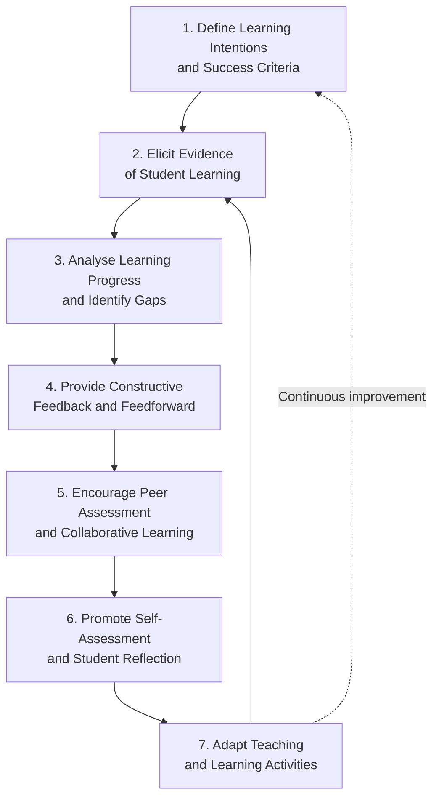
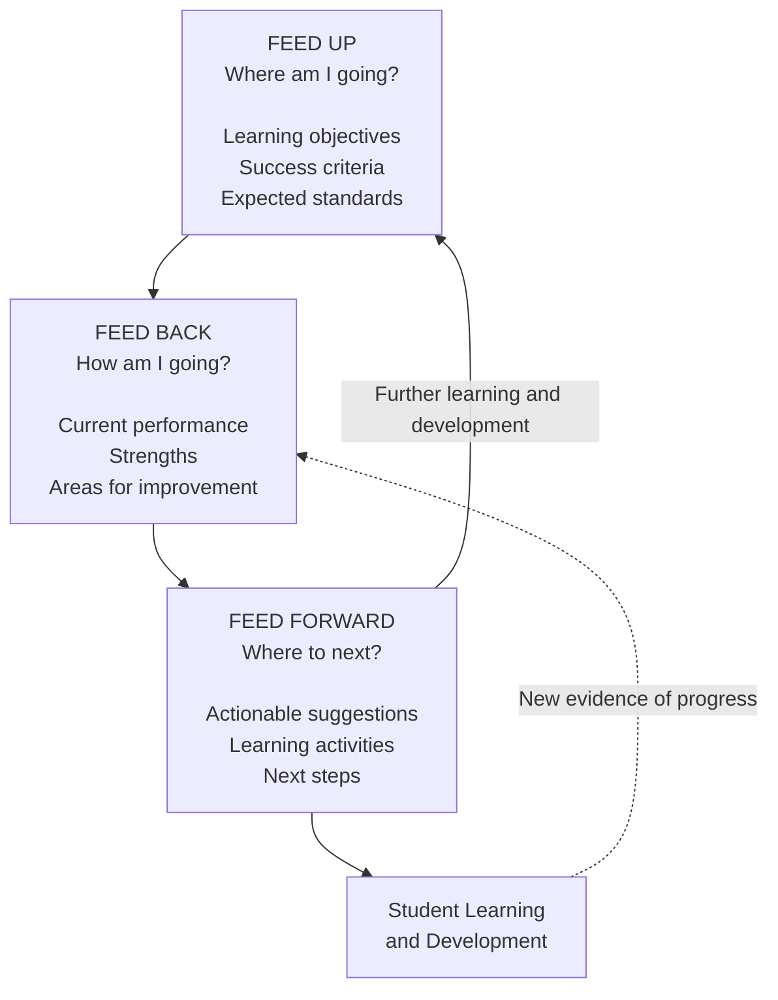

(c) 2026 Freek van den Berg. All rights reserved.

[LO1 Guiding Learning Processes](https://github.com/fatvdbergdotus/education/blob/main/LO1/README.md),
[LO2 Designing Education](https://github.com/fatvdbergdotus/education/blob/main/LO2/README.md),
[LO3 Professional Development as a Teacher](https://github.com/fatvdbergdotus/education/blob/main/LO3/README.md),
LO4 Examining and Assessing

# LO4 Examining and Assessing
Examining and Assessing focuses on designing, applying, and evaluating assessment methods to determine whether students have achieved the intended learning outcomes. It involves understanding the differences between diagnostic, formative, and summative assessment, and ensuring that examinations are valid, reliable, transparent, and fair. Teachers should select appropriate assessment methods that align with learning objectives and allow students to demonstrate their knowledge, skills, and competencies.

An important aspect of this learning outcome is using assessment as a tool to support and improve learning rather than merely measuring performance. Through formative assessment, teachers identify knowledge gaps, monitor student progress, and adapt their teaching strategies. Constructive feedback and feedforward help students understand their strengths, recognise areas for improvement, and take responsibility for their development. The frameworks of Assessment for Learning (Black and Wiliam) and the Feedback Model (Hattie and Timperley) provide valuable foundations for putting these principles into practice.

## Assessment for Learning – Black and Wiliam

**Assessment for Learning (AfL)** [[1]](#ref1)[[2]](#ref2)[[3]](#ref3)[[4]](#ref4) is an educational approach developed through the influential research of Paul Black and Dylan Wiliam. It focuses on using assessment not merely to measure what students have learned, but also to actively improve their learning while it is taking place.

The central idea is that assessment should be an ongoing part of the teaching and learning process. Rather than waiting until the end of a course to discover whether students have understood the material, teachers continuously gather information about students' knowledge, skills, understanding and difficulties. They use this information to adapt their teaching, provide feedback and help students identify areas for improvement.

### 1. The Main Principles of Assessment for Learning

Black and Wiliam's approach emphasises that assessment becomes effective when the information gathered is used to make better educational decisions.

There are five key strategies associated with their framework:

#### 1.1 Clarifying and Sharing Learning Intentions and Success Criteria

Students need to understand **what they are expected to learn and how their work will be evaluated**. Teachers should communicate learning objectives clearly and explain what successful performance looks like.

For example, in a programming course, an objective might be that students can implement a Java application using object-oriented principles. The teacher should explain the assessment criteria, such as correct functionality, appropriate use of classes and interfaces, code quality, and maintainability.

This helps students understand the expectations before starting an assignment and allows them to monitor their own progress.

#### 1.2 Eliciting Evidence of Student Learning

Teachers need to continuously gather information to understand what students know, what they have understood and where they experience difficulties. This can be achieved through classroom discussions, questions, quizzes, practical exercises, assignments and observations.

For example, after explaining Java inheritance, a teacher could ask students to implement a small class hierarchy. By examining their solutions and asking questions about their design choices, the teacher can identify whether students understand inheritance or are simply reproducing examples.

The important aspect is that assessment activities should reveal students' actual understanding, not merely whether they can reproduce information.

#### 1.3 Providing Feedback That Moves Learners Forward

Feedback should help students understand what they have done well, what needs improvement and how they can improve. Effective feedback is specific, constructive and actionable rather than simply providing a grade or indicating whether an answer is correct or incorrect.

For example, instead of telling a student that their Java implementation is incorrect, the teacher could explain that the implementation works but violates the Single Responsibility Principle. The teacher could then suggest separating the responsibilities into different classes.

Feedback should encourage improvement and help students become more independent learners.

#### 1.4 Activating Students as Learning Resources for One Another

Students can support each other's learning by sharing knowledge, discussing solutions and providing constructive feedback. Peer learning encourages collaboration and exposes students to different approaches to solving problems.

For example, students could review each other's programming assignments, discuss alternative implementations and identify potential improvements. By explaining their reasoning to classmates, students also strengthen their own understanding.

The teacher facilitates this process by establishing clear expectations for constructive and respectful peer feedback.

#### 1.5 Activating Students as Owners of Their Own Learning

Students should gradually develop the ability to evaluate their own progress, recognise knowledge gaps and take responsibility for improving their performance. This involves self-assessment, reflection, goal setting and monitoring individual learning progress.

For example, after completing a programming assignment, students could reflect on which concepts they understood well, where they encountered difficulties and what they would approach differently next time.

This encourages self-regulated learning and helps students become independent, reflective learners.

### 2. The Three Fundamental Questions

The five strategies can be organised around three fundamental questions:

| Question | Purpose |
|---|---|
| Where is the student going? | Establish learning objectives and success criteria. |
| Where is the student right now? | Identify current knowledge, understanding and difficulties. |
| How can the student get there? | Provide feedback, guidance and opportunities for improvement. |

These questions connect the activities of teachers, students and peers. Assessment therefore becomes a continuous process involving everyone in the learning environment.

#### Assessment for Learning Cycle

The following diagram illustrates how the five strategies can be applied within a continuous teaching and learning cycle.

The diagram represents Assessment for Learning as a continuous improvement cycle. Teachers establish learning expectations, gather evidence of student understanding, identify learning gaps and provide feedback. Students participate through peer assessment and self-reflection. The teacher then adapts teaching activities based on the evidence gathered, beginning another cycle of assessment and improvement.

### 3. Practical Application in Higher Education

For a university teacher, Assessment for Learning can be applied throughout a course:

1. **Before teaching:** Define learning objectives, communicate expectations and explain assessment criteria.
2. **During teaching:** Ask questions, organise discussions, use short quizzes and observe students working on practical assignments.
3. **Identifying learning gaps:** Analyse students' answers and identify misunderstandings or concepts that require further explanation.
4. **Providing feedback:** Give constructive feedback and specific suggestions for improvement.
5. **Encouraging reflection:** Let students assess their own work, review each other's work and reflect on their learning progress.
6. **Adapting teaching:** Adjust teaching activities, provide additional explanations or introduce more challenging exercises based on the evidence gathered.

### 4. Why Is This Framework Important?

The most important principle of Black and Wiliam's approach is that **assessment should influence what happens next in the learning process**.

Simply giving students a quiz, assignment or grade does not automatically constitute Assessment for Learning. The information obtained must be interpreted and used to improve learning. For example, if several students struggle with the same programming concept, the teacher should recognise this as a signal to reconsider the explanation, provide additional examples or adapt the teaching approach.

This also requires a safe learning environment in which students feel comfortable asking questions, making mistakes and acknowledging what they do not yet understand. Mistakes should be treated as valuable opportunities for learning rather than simply as failures.

**Key takeaway:** A good teacher does not simply measure what students know; a good teacher uses assessment to discover what students need to learn next.

## The Feedback Model – Hattie and Timperley

The **Feedback Model** [[5]](#ref5)[[6]](#ref6)[[7]](#ref7), developed by John Hattie and Helen Timperley (2007), explains how feedback can significantly influence student learning and achievement. Their research emphasises that effective feedback is not simply about telling students whether their answers are correct or incorrect. Instead, feedback should help students understand their current performance, identify areas for improvement and determine the next steps in their learning process.

The model considers feedback as information provided by teachers, peers, or other sources about aspects of a student's performance or understanding. Effective feedback helps close the gap between a student's current level of performance and the desired learning objectives. It should be specific, constructive, understandable and actionable. Importantly, feedback should focus on improving learning rather than simply evaluating or judging students.

### 1. The Three Fundamental Feedback Questions

Hattie and Timperley identify three fundamental questions that effective feedback should answer:

#### 1.1 Feed Up – Where Am I Going?

Feed Up focuses on establishing the learning objectives and expectations. Students need to understand what they are expected to achieve and what successful performance looks like.

Teachers should communicate learning objectives, assessment criteria and expected standards before and during learning activities. This gives students a clear direction and helps them understand the purpose of their assignments.

**Example:**

In a Java programming course, students are expected to develop an application using object-oriented programming principles. The teacher explains that students should demonstrate their understanding of encapsulation, inheritance, polymorphism and abstraction.

The assessment criteria clarify what is expected, such as correct functionality, appropriate class design, readable code and maintainability.

**Purpose:** Students understand the learning objectives and know what they are working towards.

#### 1.2 Feed Back – How Am I Going?

Feed Back provides information about a student's current performance in relation to the intended learning objectives. It helps students understand what they are doing well and where they need to improve.

Teachers can provide feedback through assignments, examinations, practical exercises, classroom discussions, observations and individual conversations.

Effective feedback should be specific and focus on the task, the learning process or the student's understanding rather than making general judgements about the student.

**Example:**

A student submits a Java application that works correctly but contains duplicated code and poorly structured classes. Instead of simply assigning a grade, the teacher explains that the application meets the functional requirements but could be improved through better object-oriented design and code reuse.

**Purpose:** Students understand their current performance, recognise their strengths and identify areas that require improvement.

#### 1.3 Feed Forward – Where to Next?

Feed Forward focuses on the next steps students should take to improve their learning and performance. It translates feedback into concrete actions and encourages continuous development.

Teachers should provide practical suggestions, additional learning resources, exercises or alternative approaches that help students achieve the intended learning objectives.

Feed Forward should encourage students to apply what they have learned to new situations and gradually become more independent learners.

**Example:**

Following feedback on their Java application, students are encouraged to refactor their code, separate responsibilities into appropriate classes, introduce interfaces where appropriate and write unit tests.

The teacher may provide additional exercises or examples to help students practise these concepts before the next assignment.

**Purpose:** Students know what actions they can take to improve their performance and continue developing their competencies.

### 2. The Feedback Cycle

The three questions are interconnected and form a continuous feedback cycle. Feedback should not be considered a one-time activity but an ongoing process that supports learning and improvement.

The cycle begins by establishing clear learning objectives. Students then receive information about their current performance and identify areas that need improvement. Finally, Feed Forward provides guidance on how to progress. As students continue learning, new evidence of their performance becomes available, allowing teachers to provide further feedback and adjust their teaching strategies.

### 3. Four Levels of Feedback

In addition to the three fundamental questions, Hattie and Timperley distinguish between four levels at which feedback can operate.

#### 3.1 Task-Level Feedback

Task-level feedback focuses on the correctness and quality of a specific assignment or activity. It helps students understand whether they have completed a task successfully and what needs to be corrected.

**Example:** A teacher explains that a Java method produces the correct output but does not handle invalid input correctly.

**Focus:** What is correct or incorrect in the task?

#### 3.2 Process-Level Feedback

Process-level feedback focuses on the strategies, methods and thinking processes students use to complete a task. It encourages students to understand why a particular approach works and how they can improve their problem-solving abilities.

**Example:** A teacher suggests that a student use decomposition to divide a complex programming problem into smaller, more manageable components.

**Focus:** What processes and strategies can improve the work?

#### 3.3 Self-Regulation-Level Feedback

Self-regulation feedback focuses on students' ability to monitor, evaluate and manage their own learning. It encourages independence, reflection, self-assessment and responsibility.

**Example:** A teacher asks a student to review their own code, identify potential improvements and explain why they selected a particular implementation.

**Focus:** How can students evaluate and regulate their own learning?

#### 3.4 Self-Level Feedback

Self-level feedback focuses on the student as a person rather than on the task or learning process. General praise, such as telling a student they are intelligent or talented, does not necessarily provide information that helps them improve.

**Example:** Saying "You are very clever" provides encouragement but does not explain what the student did well or how they can improve.

A more effective alternative would be: "Your solution is well structured because you separated the responsibilities into different classes."

**Focus:** General personal evaluation, which is generally less effective for improving learning than task-, process- and self-regulation-level feedback.

### 4. The Four Levels of Feedback – Overview

| Feedback level | Main focus | Example |
|---|---|---|
| Task | Correctness of the assignment | Your method does not handle invalid input. |
| Process | Strategies and problem-solving | Try dividing the problem into smaller components. |
| Self-regulation | Monitoring and evaluating learning | Review your implementation and identify possible improvements. |
| Self | Personal characteristics | You are very talented. |

Hattie and Timperley emphasise that task-, process- and self-regulation-level feedback can support learning, while personal praise alone is generally less useful for improving performance.

### 5. Practical Application in Higher Education

The Feedback Model can be applied throughout a university course, particularly in practical and project-based education.

For example, when students develop a Java application, a teacher can apply the feedback model throughout the development process to guide students, monitor their progress and encourage continuous improvement. The model can be applied as follows:

1. **Feed Up**: Before students begin the assignment, the teacher clearly communicates the intended learning outcomes, expected functionality and assessment criteria. Students should understand what they are expected to achieve, which programming concepts they should demonstrate and how their work will be evaluated. For example, the assignment may require students to develop a Java application using object-oriented programming principles, appropriate data structures, exception handling and a well-structured architecture. Providing a clear assignment description, examples and assessment rubrics helps students understand the expectations and gives them a direction for their learning process.

2. **Feed Back**: During the development process, the teacher regularly reviews students' implementations and provides constructive, specific and timely feedback. This feedback should address both the functional and technical aspects of the application, including code correctness, readability, maintainability, class design, architecture and adherence to programming conventions. For example, the teacher might identify inappropriate use of inheritance, insufficient encapsulation, poorly structured methods or inadequate exception handling. Rather than simply pointing out mistakes, the teacher should explain why something could be improved and encourage students to understand the underlying programming principles. This allows students to identify gaps in their knowledge and gain a better understanding of their own strengths and weaknesses.

3. **Feed Forward**: Based on the feedback provided, the teacher offers concrete suggestions and guidance that students can use to improve their current implementation and future work. For example, students might be encouraged to apply SOLID principles, improve class responsibilities, introduce interfaces, reduce code duplication, implement unit tests or use appropriate design patterns. The teacher can also suggest additional learning resources, documentation or practical exercises to help students develop specific competencies. Feed forward should not simply provide students with the correct solution; instead, it should stimulate independent thinking and help them discover better approaches themselves. In this way, feedback becomes an opportunity for further learning rather than merely an evaluation of completed work.

4. **Reflection**: Students are encouraged to critically evaluate their own work and reflect on the feedback they have received. They should consider which aspects of their implementation were successful, which difficulties they encountered and how effectively they incorporated the teacher's suggestions. For example, students could explain why they initially chose a particular class structure, what they would change in retrospect and how applying SOLID principles improved the maintainability of their application. Reflection can be supported through self-assessment forms, development journals, code reviews or short presentations. This process helps students develop self-awareness, take responsibility for their learning and become more capable of evaluating their own work.

5. **Further Development**: Finally, students should have opportunities to apply the knowledge and experience gained during subsequent assignments and projects. For example, after receiving feedback about poor separation of concerns in an initial Java application, students could be asked to design a new application using a layered architecture or an appropriate design pattern. The teacher can revisit previously identified areas for improvement and assess whether students have successfully incorporated the lessons learned. This creates a continuous learning process in which students gradually develop their programming skills, problem-solving abilities and professional competencies. It also helps students understand that software development is an iterative process in which reviewing, testing, receiving feedback and improving are essential activities.

By applying these five stages, feedback becomes an integral part of the learning process rather than something that takes place only after an assignment has been completed. Students gain a clearer understanding of expectations, receive guidance on their progress and learn how to translate constructive criticism into practical improvements. This approach also encourages independence, critical thinking and a growth mindset, which are essential competencies for students preparing for a professional career in software development.

### 6. Why Is This Framework Important?

The most important principle of Hattie and Timperley's model is that **feedback should provide students with information they can use to improve their learning and performance**.

Giving students a grade or simply telling them that their work is incorrect does not necessarily help them understand how to improve. Effective feedback provides direction, identifies specific areas for development and encourages students to take responsibility for their learning.

A supportive learning environment is essential. Students should feel comfortable asking questions, making mistakes and receiving constructive criticism. Mistakes should be treated as opportunities for development rather than as failures. Teachers should also be open to feedback from students and willing to adapt their teaching methods when necessary.

**Key takeaway:** Effective feedback does not simply tell students how they performed. It helps them understand where they are going, how they are progressing and what they can do next to improve.

# References
-  [1] Wiliam, Dylan. "What is assessment for learning?." Studies in educational evaluation 37.1 (2011): 3-14.
-  [2] Black, Paul, and Dylan Wiliam. "Classroom assessment and pedagogy." Assessment in education: Principles, policy & practice 25.6 (2018): 551-575.
-  [3] Black, Paul, and Dylan Wiliam. Inside the black box: Raising standards through classroom assessment. Granada Learning, 1998.
-  [4] Black, Paul, and Dylan Wiliam. "The formative purpose: Assessment must first promote learning." Yearbook of the National Society for the Study of Education 103.2 (2004): 20-50.
-  [5] Hattie, John, and Helen Timperley. "The power of feedback." Review of educational research 77.1 (2007): 81-112.
-  [6] Mandouit, Luke, and John Hattie. "Revisiting “The Power of Feedback” from the perspective of the learner." Learning and Instruction 84 (2023): 101718.
-  [7] Brooks, Cameron, et al. "A matrix of feedback for learning." Australian Journal of Teacher Education (Online) 44.4 (2019): 14-32.
