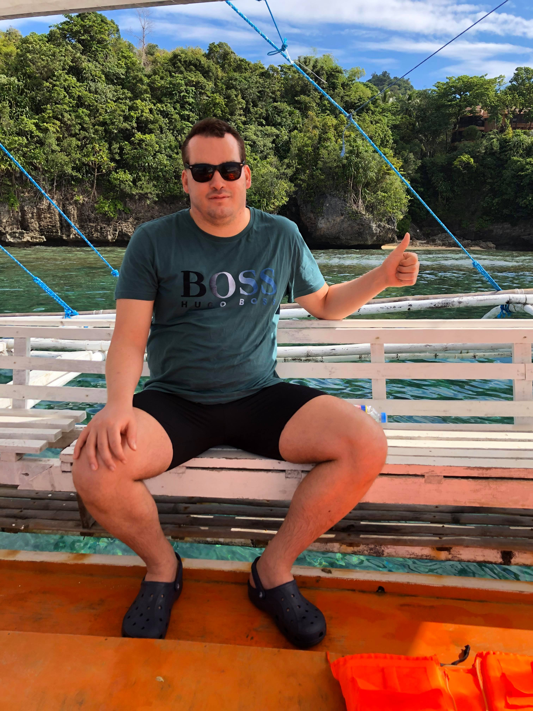

(c) 2026 Freek van den Berg. All rights reserved.

# About Me

My name is **Freek van den Berg**, and I was born in 1980. My father is a car mechanic, while my mother works as an assistant accountant. Both are naturally good with **numbers**, and I was fortunate enough to inherit this ability from them. In 2009, I passed the Mensa International test on numerical sequences. I would describe myself as passionate and **enthusiastic**, with a genuine interest in** making people feel comfortable** and having a good time. At the same time, I consider myself **modest** and down-to-earth, and I believe in **treating everyone equally**, regardless of their background or position.

## Early Years and Education

My interest in **computers** began at the age of three, when I was introduced to the highly successful **Commodore 64**. At the age of ten, I attended a computer course at Scheidegger, where I became familiar with MS-DOS and office software. However, computers were not my only interest. I also spent a considerable amount of time playing football, both on the streets and as a member of a football club, where I played for more than five years.

During primary school, I generally maintained a small circle of close friends rather than having a large social network. Although I did not always find school an easy environment, partly due to my sensitivity, I believe my cognitive abilities helped me understand and assess situations effectively.

During secondary school, I was particularly interested in subjects involving **numbers and analytical reasoning**, such as **mathematics**, **physics**, and **economics**. For seven years, I cycled 20 kilometres to school every day, regardless of the weather. This experience helped shape my perseverance and determination, and it certainly taught me to appreciate the convenience of having a car later in life!

## University and Academic Career

I studied **Information Science** at Radboud University in Nijmegen, where I obtained both my bachelor's and master's degrees (both cum laude). During my studies, I became involved in several university activities. I served as a **student assessor**, representing students on the university's education board, and worked as a **teaching assistant** for several programming courses. In the latter role, I attended practical sessions and helped students overcome difficulties with their programming assignments. I particularly enjoyed helping fellow students understand programming concepts and seeing them make progress. It was also a nice opportunity to earn some additional money alongside my studies. Several years later, I obtained an additional master's degree in **Computer Science**.

In 2012, I started my PhD at the University of Twente in collaboration with Philips Healthcare. My research focused on **evaluating the performance** of Philips medical equipment and automating this process through a Domain-Specific Language (DSL) called **iDSL**. After successfully defending my dissertation, I received my PhD in 2017.

Following my PhD, I continued my academic career as a **postdoctoral researcher** at the University of Twente, in collaboration with Wageningen University & Research. This research resulted in the development of a Domain-Specific Language for Cyber-Physical Systems called **aDSL**.

Subsequently, I joined Eindhoven University of Technology as a **postdoctoral reearcsher**, where I worked for approximately two and a half years. In collaboration with Philips Healthcare as the main industrial partner, we developed the Quality and Resource Management Language (**QRML**), another Domain-Specific Language designed to address challenges in quality and resource management.

## From Research to Teaching

A few months before my contract at Eindhoven University of Technology ended, I came across a teaching vacancy at Fontys University of Applied Sciences. This opportunity offered me the possibility of transitioning from academic research into higher education, while also providing support in obtaining my University Teaching Qualification (BKO). It additionally gave me the opportunity to gain practical experience through company visits and internships.

There are several reasons why I enjoy teaching and why I decided to pursue this career. First and foremost, I genuinely enjoy **helping people**. It gives me great satisfaction to see students absorb new knowledge, develop their skills, and mature throughout a semester. Being able to contribute to someone's personal and professional development is one of the most rewarding aspects of teaching.
Secondly, I believe teaching should be a **two-way learning process**. Although I have knowledge and experience to share, I also expect students to teach me things in return. Technology evolves rapidly, making it virtually impossible for anyone to remain fully up-to-date with every new development. Consequently, students sometimes introduce me to new technologies, approaches, or insights. I consider this exchange of knowledge a valuable part of education.
Finally, I want to **put the knowledge and experience** I have accumulated throughout my academic and professional career **to practical use**. I have spent many years working alongside highly skilled researchers and professionals, continuously developing my own expertise. I now feel that I can make a meaningful contribution by sharing this experience with younger generations and helping them develop the skills they need for their future careers.

## Hobbies and Personal Interests

Outside my professional and academic activities, I enjoy spending time on a variety of personal interests. Computers and technology have been a part of my life since early childhood, and my curiosity about technological developments has remained strong throughout the years. I enjoy exploring new technologies, experimenting with software, and expanding my technical knowledge, even outside my professional responsibilities.

**Football** has also played an important role in my life since childhood. I spent many hours playing football on the streets and was a member of a football club for more than five years. Besides the physical activity, I particularly enjoyed the social aspect and the teamwork involved. On top of this, I like watching football on television.

**Travelling** is another interest of mine. I enjoy discovering new places, experiencing different cultures, and meeting people with different backgrounds and perspectives. My academic career has provided me with many opportunities to travel internationally, which has further strengthened this interest.

In general, I enjoy activities that allow me to learn something new, challenge myself, or broaden my perspective. Whether this involves exploring technology, engaging in physical activities, or discovering new places, I appreciate opportunities to develop myself and gain new experiences.

## International Experience

My academic career has also provided me with opportunities to travel and experience different **cultures**. Through conferences, research collaborations, and other academic activities, I have visited several cities in different **countries**, including Munich, Paris, Venice, Madrid, Berlin, Prague, and Valencia. These experiences have broadened my perspective and allowed me to meet people from different backgrounds and academic disciplines.

Below are some **photographs** taken during my visits abroad.

<table align="center">
  <tr>
    <td align="center">
      
       
      <b>Denmark</b>
    </td>
    <td align="center">
      
       
      <b>Philippines</b>
    </td>
    <td align="center">
      
       
      <b>Spain</b>
    </td>
  </tr>
</table>
