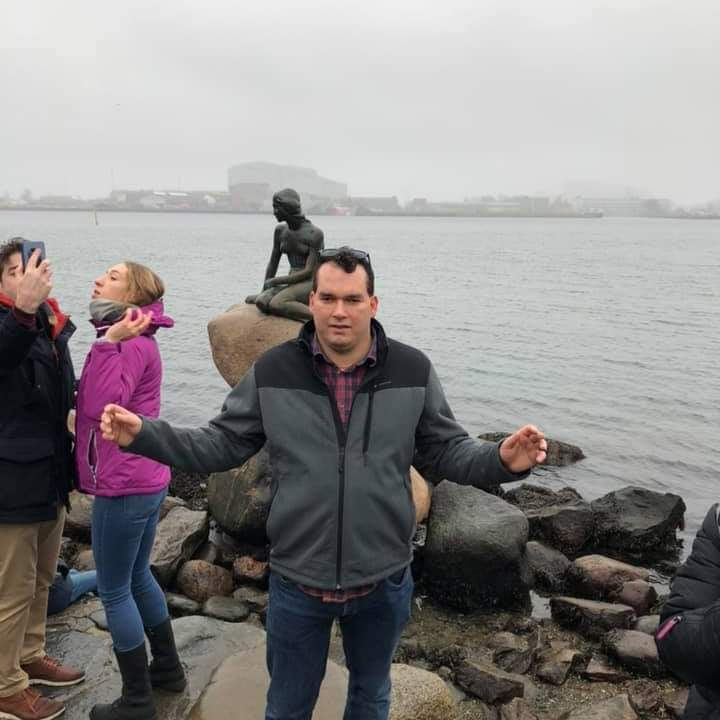
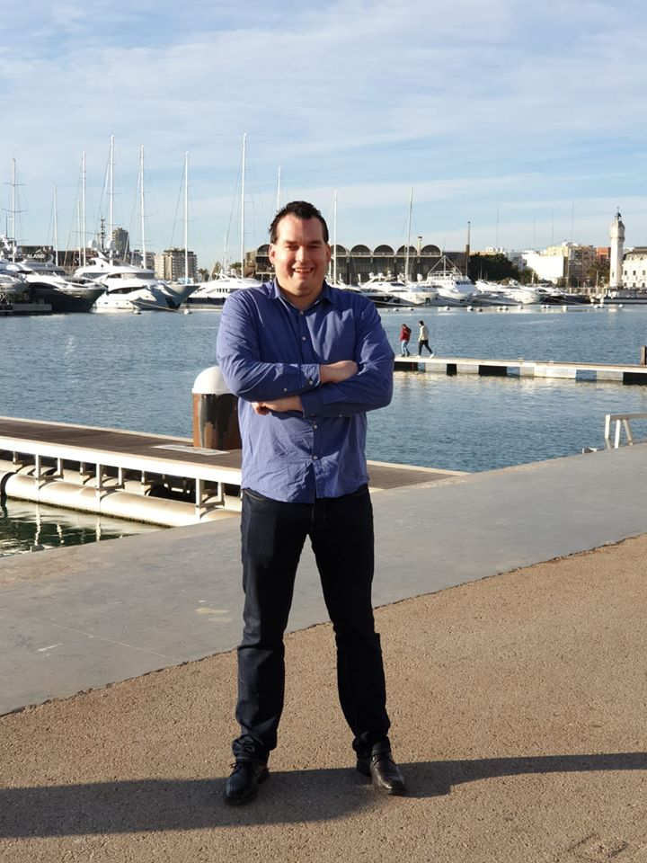

(c) 2026 Freek van den Berg. All rights reserved.

# About me
I am Freek van den Berg, 46 jaar oud. My father is a car mechanic and my mother an assistant accountant. Both of them are good with numbers and I was lucky to inherit this property from both; I passed the Mensa International test on number sequences. I have a passionate and enthusiastic personality and like to give people a good time. Furthermore, I would say I am modest, down to earth, and like to treat everyone equally.

At age three, I got in touch with a computer, namely the successful Commodore 64. At age ten, I followed a Scheidegger computer course that made me familiar with MS-DOS and an Office suite product. Meanwhile, I was not only occupied by playing on the computer, namely, I played a lot of football too. I did this on the streets and have been member of a club for over five years. During my primary school time I was always able to have friends, but instead of having many friends, I generally had a small group of friends with whom I had an intensive contact. I did not always have a good time at school because of my sensitivity but was on the other hand able to judge situations well because of my cognitive skills.

In the secondary school, I was mostly interested in the exact courses that involved numbers, e.g., mathematics, physics and economy. I had to bike 20 kilometres to get to school every day for seven years regardless of the weather. This has shaped my personality and has made me appreciate having a car later.

At the university, I studied information science in Nijmegen. This lead to a bachelor and master degree. Meanwhile, I had several jobs at the university including being a student assessor, i.e., representing the students in the education board. Next to that, I was a teaching assistant for several programming courses. For this, I attended practical classes and helped the students when they had problems with their programming assignments.  I enjoyed helping my fellow students and making some extra money aside. Several years later, I additionally received a master degree in Computer Science.

I became a PhD candidate at the University of Twente in collaboration with Philips Healthcare in 2012; I evaluated the performance of the Medical Machines of Philips and automated this using a so-called Domain Specific Language named iDSL. I received my PhD in 2017 after a successful defence.
After this, I attended a Post-Doctoral position at the University of Twente in collaboration with the Wageningen University and Research. It resulted into a Domain Specific Language for Cyber-Physical Systems called aDSL.
This was followed by a Post-Doctoral position that lasted 2.5 years at the Eindhoven University of Technology. A Domain Specific Language for Quality and Resource management, i.e., QRML, was constructed in collaboration with Philips Healthcare as the main project partner.

A few months before my contract ended, I came across a teacher vacancy at Fontys University. They offered me the opportunity to receive my teacher qualification (BKO) and also the ability to visit companies via internships. Reasons for me to be a teacher include the following. I would like to:
- to help people. It makes me feel good that my knowledge is being absorbed by them and that over the semester they mature a bit.
- the student to teach me things as much as I teach them. It is impossible to stay up-to-date with all the latest technologies, therefore it is not uncommon that the student explains things.
- that what I have learned over my lifetime can be applied in a useful way. I worked hard most of my life with people around me that have equal skills. By now working with people who are younger and have less skills yet, I feel I can really contribute.

My academic career allowed my to travel much, including trips to Germany, Venice, Madrid, Berlin, Prague and Valencia. Below are some pictures of me in foreign countries.
<table>
  <tr>
    <td align="center">
      
       
      <b>Denmark</b>
    </td>
    <td align="center">
      
       
      <b>Philippines</b>
    </td>
    <td align="center">
      
       
      <b>Spain</b>
    </td>
  </tr>
</table>
