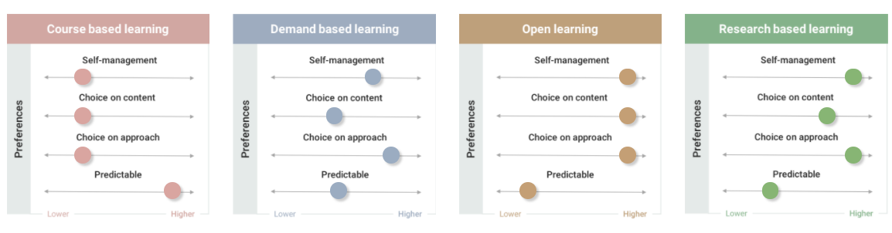

# Education methods
Education methods describe the different approaches used to organise and facilitate the learning process. They determine the roles and responsibilities of instructors and students, the degree of student autonomy, and the ways in which knowledge and skills are acquired. Different educational approaches, such as course-based, demand-based, research-based, and open learning, offer varying levels of flexibility, independence, and structure. These approaches can be compared using four dimensions: self-management, choice of content, choice of approach, and predictability. Understanding these dimensions helps explain the characteristics of each method and how they influence the overall learning experience.

### 1. Self-management

Self-management describes the extent to which students are responsible for managing their own learning process. It includes planning learning activities, setting goals, managing time, monitoring progress, and evaluating learning outcomes.

- **Lower:** The instructor determines the learning schedule, activities, and pace.
- **Higher:** Students take responsibility for planning, organising, and evaluating their own learning.

### 2. Choice of content

Choice of content describes how much freedom students have to determine what they learn. It concerns the extent to which students can select topics, subjects, learning materials, and specific knowledge areas.

- **Lower:** Learning content is predefined by the curriculum or instructor.
- **Higher:** Students can select topics based on their interests, needs, and learning objectives.

### 3. Choice of approach

Choice of approach describes the freedom students have to decide how they acquire knowledge and develop skills. It concerns the learning strategies, methods, tools, and activities used during the educational process.

- **Lower:** The instructor prescribes the learning methods, activities, and resources.
- **Higher:** Students can choose their own learning strategies, resources, and methods to achieve the learning objectives.

### 4. Predictability

Predictability describes how structured and predictable the learning environment is, including learning activities, expectations, outcomes, and assessment methods.

- **Lower:** Learning activities and outcomes are more flexible, exploratory, and potentially uncertain.
- **Higher:** Learning activities, schedules, expectations, and assessment criteria are clearly defined in advance.

## Course-based learning
Course-based learning is a structured educational approach in which students follow a predefined curriculum consisting of lectures, tutorials, practical assignments, and assessments. The learning objectives, content, and pace are primarily determined by the instructor or educational institution. This approach provides students with a systematic introduction to a subject, ensuring that essential theoretical knowledge and practical skills are acquired progressively.

## Demand-based learning
Demand-based learning is a student-centred approach in which educational activities are driven by students' individual needs, interests, and learning objectives. Students can identify specific knowledge gaps and seek relevant information, resources, or guidance to address them. The instructor acts primarily as a facilitator, supporting students in finding appropriate learning materials and developing the skills needed to solve problems independently.

## Research-based learning
Research-based learning integrates scientific research into the educational process, encouraging students to develop knowledge through investigation, experimentation, and critical analysis. Rather than relying exclusively on established theories and predefined answers, students formulate research questions, examine existing literature, collect and analyse data, and draw conclusions. This approach develops analytical thinking, problem-solving skills, scientific reasoning, and the ability to apply theoretical knowledge to real-world challenges.

## Open learning
Open learning is a flexible and accessible educational approach that gives students greater autonomy over what, when, where, and how they learn. It encourages independent learning through freely accessible educational resources, online courses, collaborative projects, and learning communities. Students can determine their own learning pace and explore subjects beyond the boundaries of a predefined curriculum. This approach promotes lifelong learning, self-motivation, adaptability, and responsibility for personal development.
